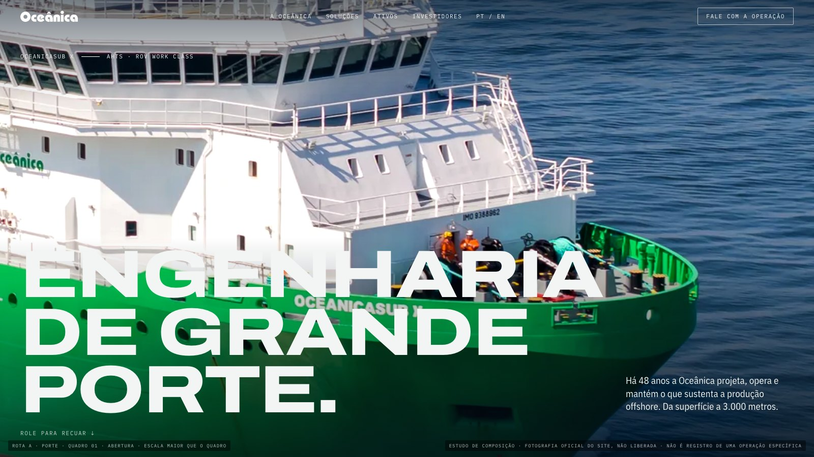
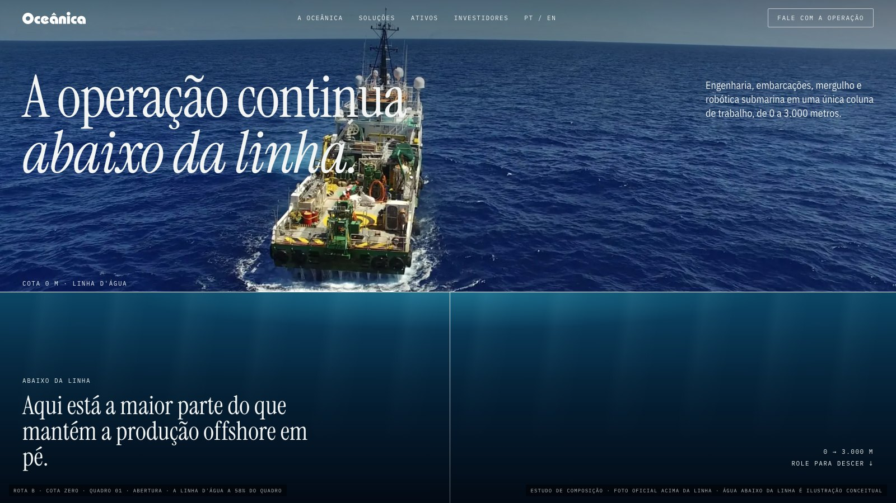
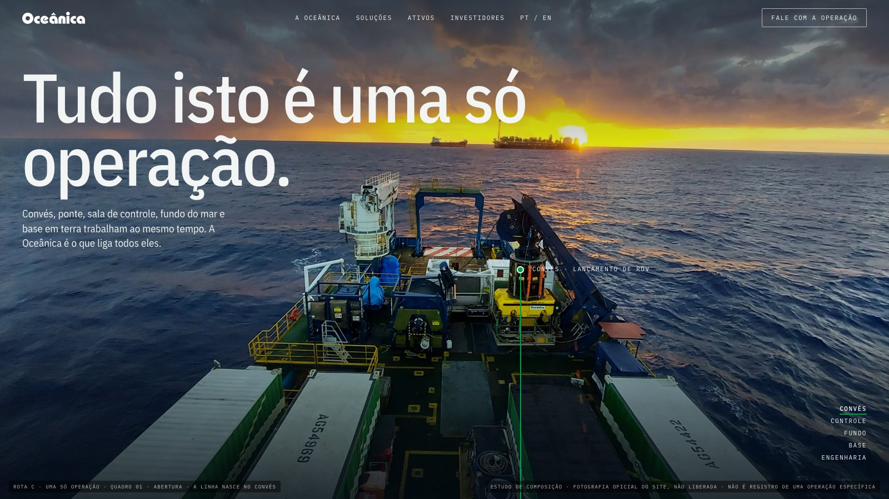

# 03 · Rotas criativas

Data: 16/11/2026. Tudo neste documento é **proposta criativa**. Os fatos que sustentam as propostas estão em `01_RESEARCH.md`.

Os quadros estão em `concept-a/frames/`, `concept-b/frames/` e `concept-c/frames/` (1600 × 900 e um mobile de 390 × 844). Para ver todos juntos, abra `index.html`.

**O que os quadros são:** estudos de composição feitos com fotografias oficiais do site, ainda não liberadas. Não são arte final nem registro de uma operação específica. Onde há ilustração (a água da Rota B, o corte da Rota C), o próprio quadro avisa.

---

## 1. A ideia central

### Maior do que se vê

Uma operação offshore é sempre maior do que a parte que aparece. O navio é grande, mas é uma peça ao lado da plataforma. A plataforma é grande, mas a maior parte do campo está abaixo dela. E o que a Oceânica entrega, integridade, só se nota quando falta.

A experiência inteira faz um único gesto: **mostra uma coisa grande e depois revela que ela é parte de outra maior.**

A pesquisa dá lastro a essa ideia. O site fala de 11 embarcações; o RI fala de 18. A receita cresceu 58% em um ano. A Oceânica é, hoje, maior do que parece.

### As oito perguntas

| Pergunta | Resposta |
|---|---|
| 1. Qual é a ideia central? | Maior do que se vê. Cada cena revela que a anterior era só uma parte |
| 2. O que o visitante deve sentir? | Primeiro, tamanho. Depois, a suspeita de que ainda não viu tudo. No fim, confiança em quem domina tudo aquilo |
| 3. O que torna a Oceânica singular? | Tem a coluna inteira dentro de casa: frota, mergulho, ROV, ferramentas e formação, de 0 a 3.000 m |
| 4. Qual imagem traduz sua dimensão? | Um casco verde que não cabe na tela e que, um recuo depois, é uma peça pequena ao lado de uma unidade de produção |
| 5. Como a engenharia vira narrativa? | Pela medida. Linhas de cota, como em desenho técnico, dão tamanho verdadeiro ao que a câmera mostra |
| 6. Como ligar superfície e profundidade? | Por uma travessia única da linha d'água, usada uma vez, no ponto em que a história desce |
| 7. Qual é o elemento memorável? | O verde do casco, enorme, em luz de dia. Ninguém na categoria abre assim |
| 8. Qual é a assinatura de câmera? | O recuo. A câmera só se afasta, e cada afastamento multiplica a escala |

As três rotas abaixo são três maneiras de filmar a mesma ideia. A Rota A mostra o que não cabe no quadro. A Rota B mostra o que está abaixo da linha. A Rota C mostra o que acontece ao mesmo tempo em outros lugares.

---

## 2. Rota A · Porte

*Hipótese do brief: Monumental Operations.*

**Mudança em relação ao brief.** O brief descreve "câmera ampla, aproximação gradual". Proponho o contrário: começar perto demais e recuar. Uma aproximação é o que ZRK e quase todo site de produto fazem. O recuo é o movimento que produz escala, porque cada passo torna pequeno o que parecia grande.

| Item | Proposta |
|---|---|
| Conceito central | O casco não cabe na tela. A cada recuo, o que era enorme vira uma peça |
| Tese | Porte se prova por comparação. "Porte" é também termo naval, a medida de capacidade de um navio |
| Sensação | Peso, presença, luz. Uma empresa que opera à vista de todos |
| Título principal | **Engenharia de grande porte.** |
| Alternativas | "Do tamanho do que está em jogo." · "Grandes operações pedem uma engenharia à altura." · "Não cabe em uma tela." |
| Em inglês | "Engineering at full scale." · "Built for the scale of offshore." |
| Texto de apoio | "Há 48 anos a Oceânica projeta, opera e mantém o que sustenta a produção offshore. Da superfície a 3.000 metros." |
| Direção fotográfica | Drone e teleobjetiva, luz de dia alta, mar azul-escuro. Aço, tinta, solda, gente em escala no convés. Nada de pôr do sol |
| Composição da abertura | Proa e superestrutura ocupando dois terços do quadro, cortadas pelas bordas. Título em três linhas embaixo à esquerda, por cima do casco. Duas pessoas de laranja no convés dão a medida |
| Paleta | Verde de casco `#009c48`, branco de superestrutura, azul do Atlântico, laranja de EPI como único ponto quente. Superfícies editoriais claras nos atos seguintes |
| Tipografia | Grotesca larga e pesada em caixa alta, como letreiro de casco (estudo: Archivo Expanded 800). Mono pequena para legendas (IBM Plex Mono). Licenciar equivalente na produção |
| Luz | Sol alto, sombras curtas, contraste natural. A única rota que não depende de escuro |
| Escala e perspectiva | Três degraus: detalhe de casco, navio inteiro, navio ao lado da unidade. Linhas de cota finas entram no segundo degrau com medidas reais |
| Movimento de câmera | Recuo contínuo com leve subida, sem cortes, amarrado ao scroll em cerca de três alturas de tela. O título encolhe e vira legenda |
| Parallax | Físico: o navio avança, a esteira fica, o mar passa por baixo. Tipografia fixa; só o mundo se move |
| Passagem para o ato 02 | O último recuo deixa o navio pequeno ao lado da unidade. No espaço que sobra entra o primeiro número com lastro: a frota |
| Mobile | Composição vertical própria: o casco sobe pela tela, título em três linhas no terço inferior. O recuo vira subida de drone, que funciona em retrato |
| Produção necessária | Vídeo de drone original da Oceânica com recuo real (o melhor caminho) **ou** fotografia original em resolução plena para um recuo digital de 3 a 4 vezes. Uma tomada da embarcação junto a uma unidade com o casco verde atual. Fichas técnicas para as cotas |

**Quadros:** `concept-a/frames/1.jpg` (abertura), `2.jpg` (recuo, o título vira legenda), `3.jpg` (entrada do ato 02), `m.jpg` (mobile).

**Crítica.**

- O primeiro quadro pode ser lido como "empresa de navegação". O texto de apoio e a etiqueta "ROV Work Class" seguram a leitura, mas o subsea só aparece de verdade no ato 03. É o risco principal da rota.
- Nos estudos, o quadro 03 usa outra embarcação, com pintura antiga. A continuidade do recuo só existe se houver uma tomada real. Sem ela, o recuo vira dois planos colados.
- A foto atual não aguenta o recorte do quadro 01 em tela grande. Depende do original.
- "Engenharia de grande porte" é uma afirmação de tamanho. Se a imagem não entregar tamanho, a frase soa vazia.

---

## 3. Rota B · Cota Zero

*Hipótese do brief: Above / Below.*

**Mudança em relação ao brief.** O brief pede superfície e profundidade "sem aspecto de infográfico". Proponho assumir o desenho técnico em vez de fugir dele: a linha d'água vira uma linha de cota, fixa na tela, e a coluna é mostrada **em escala real**. A surpresa é honesta: na mesma escala dos 3.000 m, o navio é um traço.

| Item | Proposta |
|---|---|
| Conceito central | A linha d'água é a cota zero de um desenho. Acima, o que se vê. Abaixo, a maior parte |
| Tese | A profundidade só impressiona quando é medida com a mesma régua da superfície |
| Sensação | Silêncio, vertigem controlada, precisão |
| Título principal | **A operação continua abaixo da linha.** |
| Alternativas | "Da superfície a 3.000 metros, a mesma engenharia." · "O que se vê é a menor parte." · "Abaixo da linha, o trabalho começa." |
| Em inglês | "The operation continues below the line." · "From the surface to 3,000 metres. One engineering." |
| Texto de apoio | "Engenharia, embarcações, mergulho e robótica submarina em uma única coluna de trabalho, de 0 a 3.000 metros." |
| Direção fotográfica | Acima: embarcação em mar aberto, horizonte limpo, luz fria. Abaixo: sem fotografia inventada. Água como atmosfera gerada, e registro real de ROV só na chegada ao fundo |
| Composição da abertura | Linha branca de um pixel a 58% da altura. Acima, a embarcação de popa e o horizonte. Abaixo, água que escurece. Uma linha vertical, o umbilical, desce do navio e sai pelo pé do quadro |
| Paleta | Azul de superfície, azul-petróleo, quase preto no fundo. Branco para linhas e texto. Verde só na marca |
| Tipografia | Serifa editorial de alto contraste para frases e números (estudo: Instrument Serif), mono para as cotas. É a rota mais calma e mais literária |
| Luz | Luz de dia acima. Abaixo, a luz cai com a profundidade até sobrar só o farol do ROV |
| Escala e perspectiva | Corte frontal, sem perspectiva. Escala vertical declarada no quadro. Marcas em 50 m (mergulho raso), 300 m (limite do mergulho humano, citado no site) e 3.000 m |
| Movimento de câmera | Descida vertical pelo umbilical. A linha d'água sobe e trava no topo, onde vira a régua de navegação. A descida acelera nos trechos vazios para não prender o visitante |
| Parallax | A linha e as cotas são fixas. A água, a luz e as partículas de sedimento passam em velocidades diferentes. O navio encolhe até virar uma marca |
| Passagem para o ato 03 | A chegada ao fundo: o farol do ROV acende a cena e o número 3.000 entra. A história passa da medida para a capacidade |
| Mobile | A melhor das três em retrato: a coluna é vertical por natureza. Linha no meio da tela, o polegar desce |
| Produção necessária | Tomada de superfície com o casco verde atual. Coluna d'água gerada (atmosfera, permitida pelo brief). Vídeo original de ROV em intervenção. Medidas reais do navio para a escala |

**Quadros:** `concept-b/frames/1.jpg` (abertura), `2.jpg` (300 m, a coluna em escala), `3.jpg` (fundo, entrada do ato 03), `m.jpg` (mobile).

**Crítica.**

- É a rota mais próxima do que as versões V02 a V05 já tentaram (descida, número de profundidade). O brief diz que essas versões acumularam metáforas. Há risco real de refazer o mesmo filme com outra roupa.
- Metade da primeira tela é água vazia. Nos primeiros segundos ela comunica mistério, não porte. O brief pede porte.
- Depende de imagem submarina que não existe em qualidade. O único registro de fundo tem 811 px de altura.
- A escala real tem um custo: 3.000 m honestos são muito scroll ou muita aceleração. Ou cansa, ou trapaceia.
- O ROV no fim volta a ser protagonista sozinho, um dos erros que o brief lista.

---

## 4. Rota C · Uma Só Operação

*Hipótese do brief: Connected Engineering.*

**Mudança em relação ao brief.** O brief fala em "movimento de câmera revelando conexões". Proponho que a conexão seja um objeto físico: uma linha verde contínua, que é umbilical, cabo, rota e turno, e que o visitante segue do convés ao fundo e de volta à base. A mesma linha vira a navegação do Universe.

| Item | Proposta |
|---|---|
| Conceito central | Um instante, várias frentes. Tudo o que aparece está acontecendo ao mesmo tempo |
| Tese | O que a Oceânica vende é a ligação entre as partes, e não cada parte |
| Sensação | Coordenação, domínio, turno de trabalho |
| Título principal | **Tudo isto é uma só operação.** |
| Alternativas | "Seis frentes. O mesmo instante." · "Uma operação. Todas as frentes." · "O que liga tudo é engenharia." |
| Em inglês | "All of this is one operation." · "Six fronts. One moment." |
| Texto de apoio | "Convés, ponte, sala de controle, fundo do mar e base em terra trabalham ao mesmo tempo. A Oceânica é o que liga todos eles." |
| Direção fotográfica | Reportagem de turno: pessoas trabalhando, mãos, telas reais de pilotagem, convés, oficina. Mesma hora do dia em todas as frentes |
| Composição da abertura | Convés ao amanhecer em tela cheia, visto da ponte. Um ponto verde no convés e uma linha que desce e sai do quadro. Título no alto à esquerda |
| Paleta | Cinzas de aço e azul-noite, luz quente do amanhecer, verde na linha. O Universe abre em superfície clara |
| Tipografia | Grotesca condensada de prancha técnica (estudo: IBM Plex Sans Condensed), mono para rótulos |
| Luz | Amanhecer na superfície, luz de trabalho nos interiores, farol no fundo |
| Escala e perspectiva | Escala humana. A câmera fica à altura dos olhos de quem trabalha |
| Movimento de câmera | Travelling pela linha. O plano único se abre em janelas, cada uma em um ponto da linha, e depois as janelas se fecham em pontos de um corte |
| Parallax | Entre janelas: cada uma tem movimento próprio e lento, e a linha atravessa todas na mesma velocidade |
| Passagem para o capítulo seguinte | As janelas encolhem e viram os pontos do Universe. É a passagem mais natural das três para o ato 04 |
| Mobile | A linha vira o trilho do polegar, com uma frente por tela |
| Produção necessária | A maior das três: captação dedicada de ponte, sala de controle, convés, oficina e base, na mesma luz. Quase nada disso existe hoje |

**Quadros:** `concept-c/frames/1.jpg` (abertura), `2.jpg` (as frentes simultâneas), `3.jpg` (entrada do Universe), `m.jpg` (mobile).

**Crítica.**

- O quadro 02, do jeito que está, é uma grade de cartões. É exatamente o que o brief manda evitar. Só funciona se as janelas forem filme sincronizado, e esse filme não existe.
- É a rota menos monumental no primeiro segundo. Um convés ao amanhecer é bonito, mas não diz "grande porte".
- "Ao mesmo tempo" é uma promessa de simultaneidade. Fotos de 2021 e 2024 misturadas não a cumprem.
- A linha verde pode escorregar para o infográfico se ganhar ícones, rótulos e brilhos.
- É a que mais depende de produção nova e, portanto, de prazo e orçamento que ainda não conhecemos.

---

## 5. As três lado a lado

| Critério | A · Porte | B · Cota Zero | C · Uma Só Operação |
|---|---|---|---|
| Diz "grande porte" no primeiro segundo | Sim | Parcial | Não |
| Mostra o subsea na abertura | Não; vem no ato 03 | Sim | Parcial |
| Distância das versões anteriores | Grande | Pequena | Média |
| Distância do que o setor faz | Grande: ninguém abre em macro de casco | Grande: ninguém usa a coluna como eixo | Média: mosaicos existem |
| Assets reais disponíveis hoje | Bons, com ressalva de resolução | Fracos abaixo da linha | Fracos |
| Risco de autenticidade | Baixo | Médio: água gerada | Baixo, se tudo for captado |
| Mobile | Bom | Ótimo | Bom |
| Custo de produção | Médio | Médio | Alto |
| Leva ao Universe | Por mais um recuo | Pelo fundo | Diretamente |
| Maior risco | Parecer empresa de navegação | Refazer a V02 a V05 | Virar grade de cartões |

A recomendação e as razões estão em `05_RECOMMENDATION.md`.
