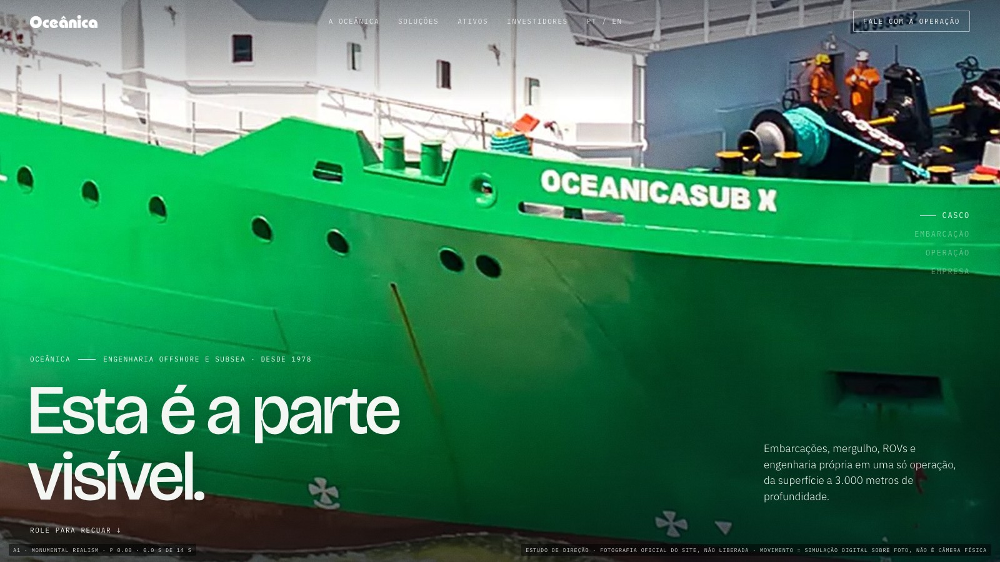
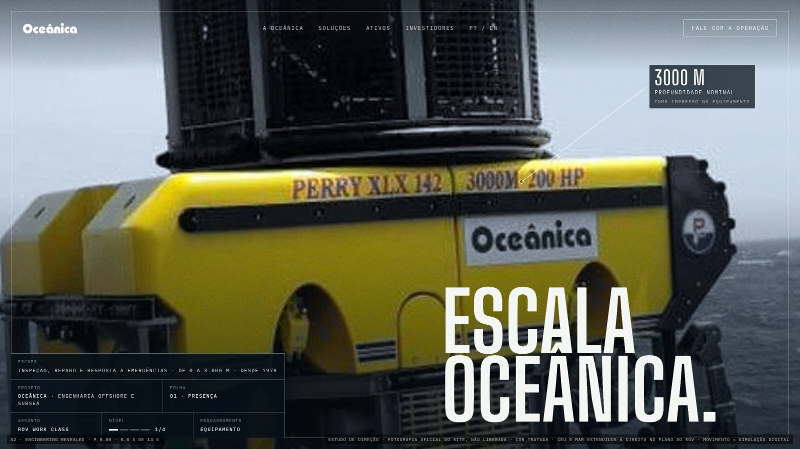
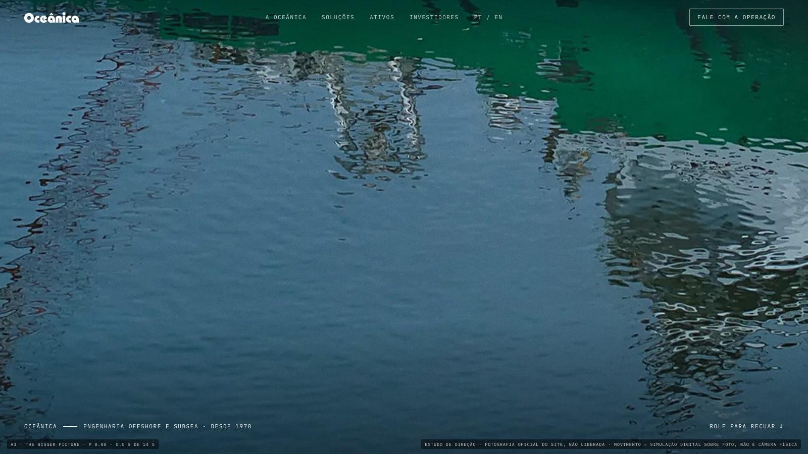

# 01 · Direção da hero

Data: 16/11/2026. Etapa: aprofundamento da Rota A (Porte). Só o ato 01 (Presença) e a passagem para o ato 02 (Escala).

Base aprovada: conceito "Maior do que se vê", Rota A, recuar para revelar. Não aprovados e substituídos aqui: a composição anterior, os key visuals anteriores e o título "Engenharia de grande porte".

Lidos antes de começar: o Master Brief e os cinco documentos de `creative/` (01 a 05). Nada deles foi alterado.

---

## 1. Workspace

| Pergunta | Resposta |
|---|---|
| Diretório atual | `/Users/tiagolima/Desktop/LANDING OCEANICA/v06` |
| Onde estão o brief e os estudos | Brief em `v06/`. Estudos em `v06/creative/`. Esta etapa em `v06/creative/hero-refinement/` |
| Relação com o repositório antigo | `v06/` é uma pasta dentro do repositório `oceanica-landing` (remoto `aera-company/oceanica-landing`). O Git a vê como não rastreada: nada de `v06/` foi commitado, então não existe histórico a preservar nem a perder |
| O que foi alterado fora de `v06/` | Nada |

**O isolamento depende de uma mudança externa, que não fiz.** A solução, quando você autorizar:

1. Mover `v06/` para `~/Desktop/OCEANICA-FLAGSHIP/`.
2. Rodar `git init` lá e fazer o primeiro commit com tudo o que existe.
3. Corrigir as referências de `02_ASSET_INVENTORY.md` que apontam para `../../public/` e `../../media-src/` (pastas do repositório antigo).

Esta etapa já foi feita para sobreviver à mudança: `hero-refinement/` só usa arquivos de dentro de `creative/`.

---

## 2. O que muda em relação à Rota A original

A Rota A abria com um navio. Um navio sozinho diz "navegação". O que precisa ficar claro é engenharia offshore e subsea.

A correção é de **assunto**, e não só de estilo. Os três tratamentos mantêm o recuo, mas cada um escolhe um primeiro objeto e uma maneira diferente de chegar à operação:

| | A1 · Monumental Realism | A2 · Engineering Revealed | A3 · The Bigger Picture |
|---|---|---|---|
| Primeiro objeto | O casco | O ROV, com "3000 M" escrito nele | Um reflexo na água |
| Degraus do recuo | Casco → embarcação → operação → empresa | Equipamento → sistema → embarcação → campo | Reflexo → embarcação → entorno → mar aberto |
| Onde a engenharia aparece | No terceiro degrau | No primeiro quadro | Quase não aparece |
| Linguagem | Filme institucional, cor natural | Cinema com camada de desenho técnico | Filme de marca, quase sem texto |
| Título em estudo | "Esta é a parte visível." | "Escala oceânica." | "Quanto mais longe, maior." |
| Fotografias usadas | SUB X e apoio a unidade | ROV em lançamento e convés | SUB XI no cais e mar aberto |

Nenhuma fotografia se repete entre tratamentos.

---

## 3. O que absorvi das referências

Sem pesquisa nova; uso o que está em `01_RESEARCH.md`.

| Da ZRK | Como entra aqui |
|---|---|
| A interface fica parada e o mundo se move | Nos três tratamentos o título não se anima. Só a câmera se move |
| Um assunto por vez | Cada quadro tem um único objeto iluminado pela atenção |
| Dois tamanhos de texto | Título grande e mono de 11 px. Nada no meio |
| O número responde a uma pergunta | Cada número entra quando o objeto que o prova está em quadro |
| A prova vem depois do desejo | O ato 02 só começa quando o recuo termina |

| Da Emons | Como entra aqui |
|---|---|
| Continuidade espacial | O recuo nunca muda de direção. Onde há corte, ele é declarado |
| Mundo conectado | No A2, a linha de visada liga o convés à unidade no horizonte |
| Clareza | O indicador de degrau (casco, embarcação, operação, empresa) diz sempre onde o visitante está |

**Não transferi:** preto contínuo, retículas, telemetria, sequestro de scroll, estética de maquete.

---

## 4. A1 · Monumental Realism

| | Direção |
|---|---|
| **Câmera** | |
| Posição inicial | Drone à altura do convés, pela bochecha de bombordo, perto o bastante para o casco passar das bordas |
| Distância focal | Teleobjetiva, equivalente a 70–85 mm. A compressão transforma o casco em parede |
| Perspectiva | Três quartos de proa, levemente de cima |
| Direção e movimento | Recuo com subida suave, em uma tomada só. A lente não muda |
| Velocidade | Dois segundos parado. Depois acelera devagar e chega devagar. Nada de arranque |
| Ponto de revelação | Quando a ponta da proa entra em quadro, a cerca de um terço do percurso |
| **Luz** | Sol alto e lateral, contraste natural, temperatura neutra. Sem pôr do sol, sem névoa |
| **Assunto** | Principal: casco verde com o nome pintado. Secundários: duas pessoas de laranja na proa (dão a medida), esteira, unidade de produção. A embarcação sempre maior que qualquer elemento gráfico |
| **Tipografia** | Grotesca de caixa mista, peso 500, 112 px em 1600, duas linhas, alinhada embaixo à esquerda (estudo: Bricolage Grotesque). Fica parada do quadro 01 ao 03. Encolhe para legenda quando a operação entra |
| **Marca** | O verde é o próprio casco: nenhum verde na interface. Logotipo só na navegação. O nome da embarcação pintado no costado faz o papel de assinatura |
| **Profundidade** | Primeiro plano: amurada e pessoas. Meio: casco. Fundo: mar e esteira. Com vídeo real há paralaxe verdadeira entre os três. Com foto, não há |
| **Edição** | 14 s conceituais, cerca de três alturas de tela. Mensagem presente desde o primeiro quadro. Um corte (do navio para a operação), que no filme final precisa ser tomada contínua. Entrega: o filme encolhe e vira um quadro na página clara do ato 02 |

Storyboard completo: `A1/STORYBOARD.md`.

---

## 5. A2 · Engineering Revealed

| | Direção |
|---|---|
| **Câmera** | |
| Posição inicial | Fora da borda, à altura do ROV suspenso. O bloco amarelo com a inscrição ocupa o quadro |
| Distância focal | Longa no começo (100 mm ou mais) abrindo para grande-angular: zoom óptico combinado com recuo |
| Perspectiva | Frontal, quase de elevação, como em um desenho. No convés, de cima e de popa |
| Direção e movimento | Recuo reto, sem subida. Depois um corte por semelhança: o ROV suspenso vira o ROV estivado no convés |
| Velocidade | Constante e contida. É o tratamento mais calmo |
| Ponto de revelação | Quando o TMS e a lança do LARS entram: o objeto vira sistema |
| **Luz** | Difusa, de céu encoberto. Contraste médio, sem sombra dura |
| **Cor** | O mundo vai para cinza de aço. Só o verde da marca e o amarelo do equipamento guardam cor. No último quadro, o sol do horizonte entra na mesma faixa de amarelo |
| **Assunto** | Principal: ROV Work Class. Secundários: TMS, LARS, convés, unidade no horizonte. Hierarquia por cor: o que tem cor é o assunto |
| **Tipografia** | Condensada pesada em caixa alta, 164 px, duas linhas, embaixo à direita (estudo: Big Shoulders Display). Lembra marcação de casco e de prancha. Mono de 11 px nas anotações |
| **Camada gráfica** | Moldura de folha de desenho, parada. Carimbo embaixo à esquerda com assunto, nível (1/4 a 4/4) e escopo. No máximo três chamadas por quadro, todas presas a um ponto real da imagem. Uma única cota (altura do conjunto), sem valor até a ficha técnica chegar |
| **Marca** | Verde só onde ele existe na foto (convés, contêineres). A marca aparece no próprio equipamento: a etiqueta "Oceânica" no ROV |
| **Profundidade** | ROV em primeiro plano contra céu e mar: o recorte é limpo e já existe máscara. É o único tratamento em que o 2.5D é honesto |
| **Edição** | 14 s. Um corte por semelhança aos 6 s. Entrega: o carimbo abre e mostra a folha 02, com cada número e a sua fonte |

Regra que evita o HUD: **nenhuma anotação existe sem um objeto real embaixo dela, e nenhum número aparece sem fonte.** O "3000 M" do primeiro quadro está impresso na máquina.

Storyboard completo: `A2/STORYBOARD.md`.

---

## 6. A3 · The Bigger Picture

| | Direção |
|---|---|
| **Câmera** | |
| Posição inicial | Baixa sobre a água, olhando para baixo, só o reflexo em quadro |
| Distância focal | Normal, perto de 50 mm |
| Perspectiva | Começa quase a pino e termina oblíqua |
| Direção e movimento | Um único gesto de grua: inclina para cima, sobe e recua ao mesmo tempo |
| Velocidade | Lenta no reflexo, mais rápida depois que o navio é reconhecido |
| Ponto de revelação | Quando a linha d'água cruza o quadro e o casco aparece acima do próprio reflexo |
| **Luz** | Sol alto, água calma, verde e turquesa. No corte, azul profundo de mar aberto |
| **Assunto** | Principal: o reflexo, depois a embarcação. Secundários: guindaste, cais, tanques. No fim, uma embarcação sozinha no Atlântico |
| **Tipografia** | Serifa leve em itálico, 112 px, uma linha só, no último quadro (estudo: Fraunces). Antes disso, só mono de 11 px |
| **Marca** | O verde chega antes do navio, pelo reflexo. É o uso mais delicado da cor entre os três |
| **Profundidade** | Água em primeiro plano, casco no meio, cais ao fundo. A simetria entre navio e reflexo organiza o quadro |
| **Edição** | 14 s. Dez segundos em uma tomada, depois um corte seco do cais para o mar aberto. O título só entra aos 11 s |

Storyboard completo: `A3/STORYBOARD.md`.

---

## 7. A passagem para o ato 02 · Escala

O ato 02 não começa com quatro contadores. Ele é **mais um degrau do mesmo recuo**:

**Elemento → embarcação → operação → empresa.**

Cada número entra quando o objeto que o prova ainda está em quadro, e sempre na forma "isto era um de tantos".

| Degrau | O que está em quadro | Prova que entra | Valor e fonte |
|---|---|---|---|
| Elemento | O ROV (A2) | "Este é um de…" | **55** · RI, release 1T26, 13/05/2026 (13 Work Class e 42 de observação). **56** · site, lido em 16/11/2026 |
| Embarcação | O navio | "Esta é uma de…" | **18** · RI, release 1T26, posição de março de 2026. **11** nomeadas · site, 16/11/2026. A imprensa citou 19 na ROG.e 2026 (não conferido) |
| Operação | Convés, pessoas, unidade | "Quem opera…" | **2.378** colaboradores · RI, release 1T26. Site: "+ 2.300" |
| Empresa | Linha da frota, base | "Desde…" | **1978**, 48 anos em 2026 · site. Muda em 2027 |

**Não escolhi entre os números divergentes.** Os quadros mostram os dois valores, cada um com a fonte, e a marca "validar antes de publicar". A profundidade (contratos de 0 a 3.000 m, segundo o site) fica para o ato 03.

Como cada tratamento faz a entrega:

- **A1:** o filme encolhe e vira um quadro em uma página clara. O último recuo é sair do próprio filme. A linha de 18 traços mostra a embarcação que o visitante acabou de ver como uma entre as demais.
- **A2:** o carimbo da folha abre para cima e vira a folha 02. Frota, ROVs e pessoas aparecem como campos de prancha, com fonte e divergência.
- **A3:** uma linha de mono sob o título: "Uma de 18 embarcações". É a entrega mais discreta e a mais fraca como prova.

---

## 8. O que os estudos são e não são

- São composições feitas com fotografias do site oficial, ainda não liberadas.
- O movimento é **simulação digital sobre fotografia**: um reenquadramento progressivo. Não tem paralaxe, não tem água em movimento e não equivale a uma câmera física. Cada quadro traz esse aviso.
- No A2, a cor foi tratada e o céu e o mar foram estendidos à direita no plano do ROV. O aviso está no quadro.
- Nenhuma imagem foi gerada. Nenhum crédito foi gasto.
- A página `index.html` desta pasta é um ambiente de comparação. Não é o site.
