# 03 · Comparação visual

Data: 16/11/2026. Para ver quadros e animatics juntos, abra `index.html` nesta pasta.

Cada tratamento tem quatro keyframes de 1600 × 900, um estudo mobile de 390 × 844 e um animatic de 14 s (`animatic.mp4`, 1280 × 720). O `index.html` de cada pasta é o animatic interativo, com play, barra de tempo e scroll.

---

## 1. Os doze quadros

| | 01 · Hook | 02 · Reveal | 03 · Expansion | 04 · Handoff |
|---|---|---|---|---|
| **A1** | 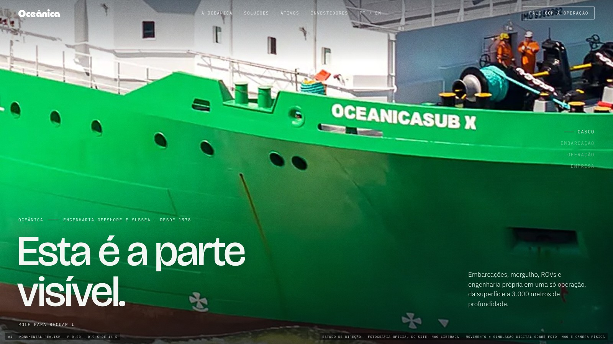 | 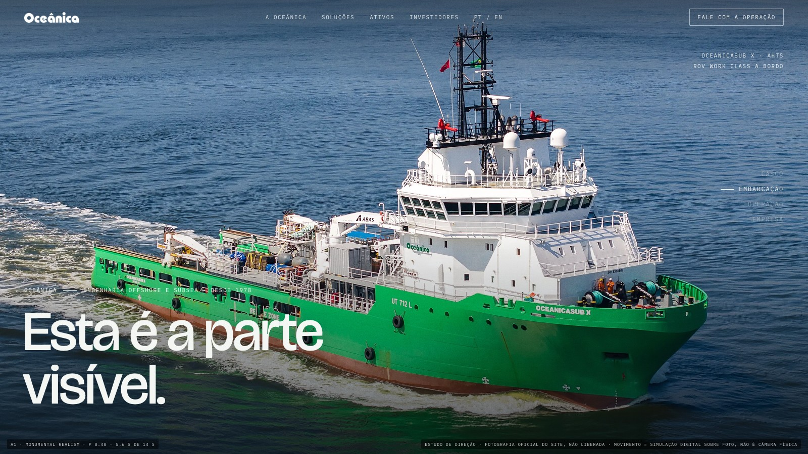 | 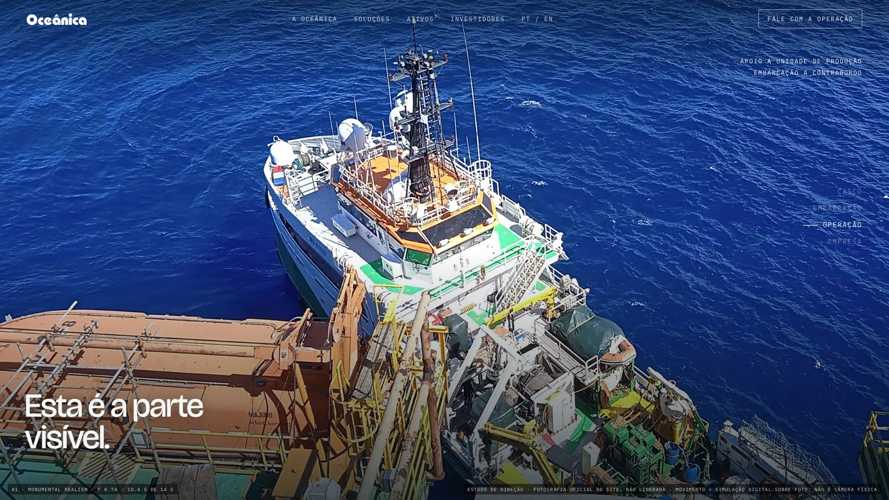 | 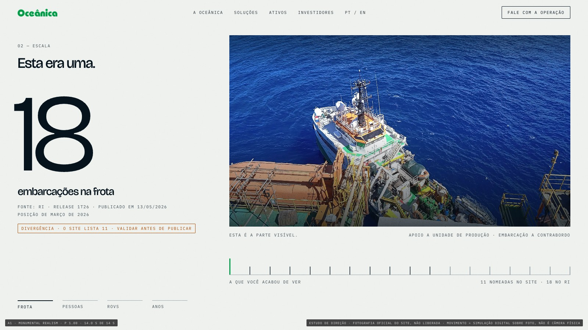 |
| **A2** | 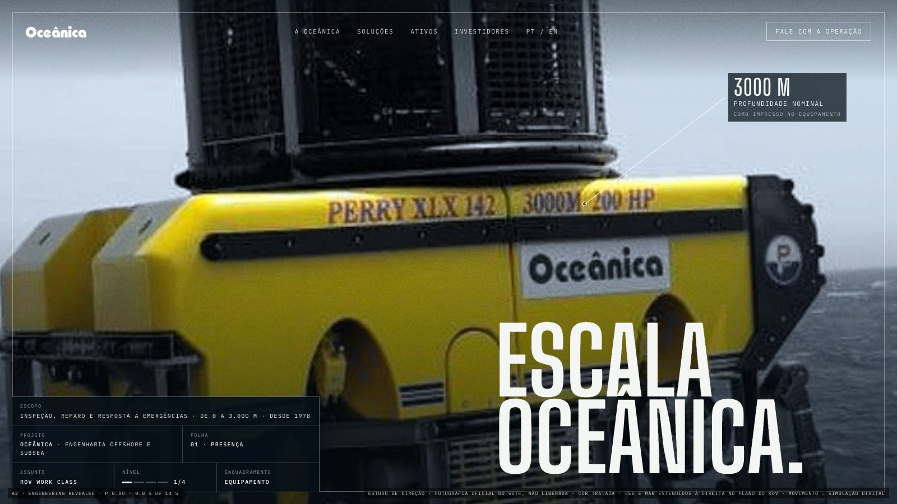 | 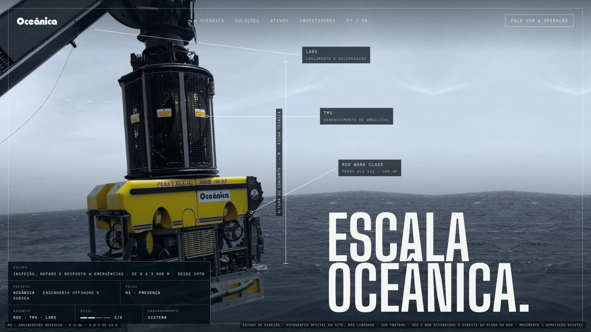 | 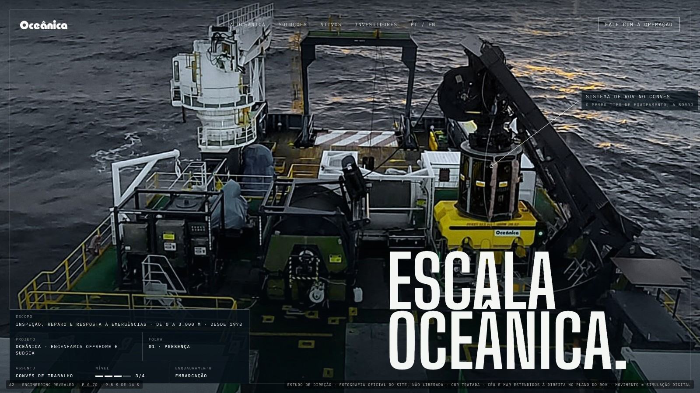 | 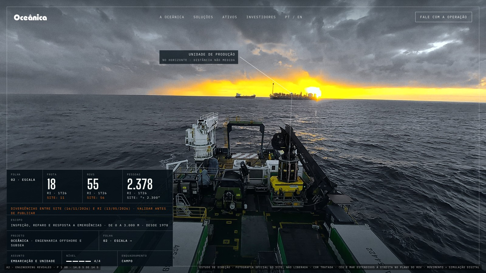 |
| **A3** | 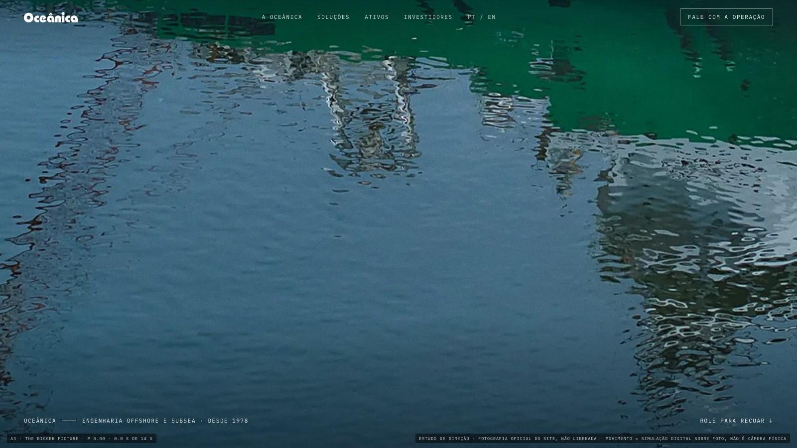 | 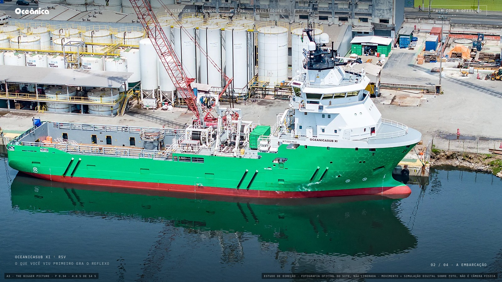 | 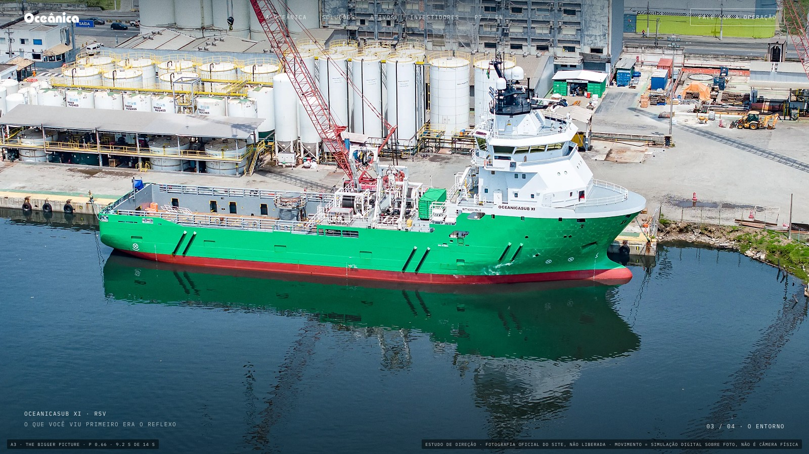 | 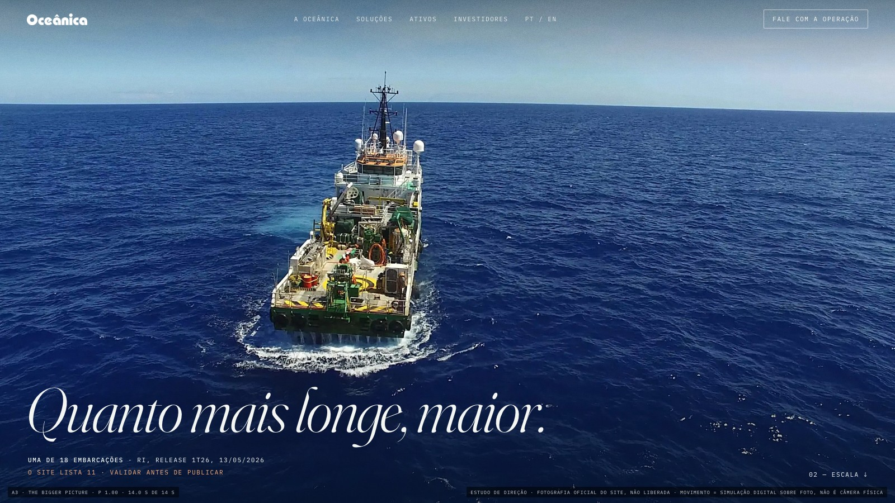 |

Mobile: `A1/frames/m.jpg`, `A2/frames/m.jpg`, `A3/frames/m.jpg`.

---

## 2. Quality gate

Respostas minhas, sobre os estudos como estão.

| # | Pergunta | A1 | A2 | A3 |
|---|---|---|---|---|
| 1 | A imagem impressiona antes do texto? | Sim. A parede verde funciona | Sim. O amarelo no cinza segura o olho | Parcial. Intriga, mas não impressiona |
| 2 | Reconhecemos a Oceânica? | Sim: nome no casco e o verde | Sim: a etiqueta da marca está no ROV | Só no segundo quadro |
| 3 | Parece maior que nas versões anteriores? | Sim | Sim, e mais capaz | Parcial |
| 4 | A composição é original? | Média. Macro de casco é raro no setor, mas é um navio | Alta. Ninguém no setor trata foto como prancha | Alta como gesto, baixa como assunto |
| 5 | A fotografia tem qualidade de cinema? | Não ainda. O macro está ampliado 2,2 vezes e fica mole | Não ainda. A foto do ROV é de 1834 px; o tratamento de cor disfarça, não resolve | A melhor das três: 1,7 vez de ampliação, foto de 2800 px |
| 6 | A engenharia aparece como capacidade real? | Pouco. Só no terceiro quadro, e por contexto | Sim, desde o primeiro quadro | Não |
| 7 | O movimento gera revelação verdadeira? | Sim do casco ao navio. Do navio à operação há um corte para outra embarcação | Sim do detalhe ao sistema. O corte para o convés é por semelhança e se sustenta | Sim. É a revelação mais limpa: reflexo, depois navio |
| 8 | A tipografia tem personalidade? | Média | Alta | Alta, mas puxa para marca de luxo |
| 9 | A passagem para o ato 02 faz sentido? | Sim. Sair do filme é o último recuo | Sim. O carimbo vira a folha 02 | Fraca. Uma linha de texto |
| 10 | É viável técnica e financeiramente? | Depende de captação com a unidade | A mais viável | Viável, com dúvida sobre o cenário |

**Os três são variações cosméticas?** Não. Mudam o primeiro objeto, a cor, a tipografia, a posição do texto, o tipo de corte e a entrega para o ato 02. Nenhuma fotografia se repete.

**A qualidade é superior à das versões anteriores?** Em direção, sim. Em qualidade de imagem, **não posso afirmar**: os estudos usam as mesmas fotografias do site que já estavam no projeto, e em macro elas estão ampliadas além do que aguentam. Não comparei lado a lado com a V01 nesta etapa. O ganho real de imagem depende dos originais ou de captação.

---

## 3. Leitura crítica de cada um

### A1 · Monumental Realism

- **Acerta:** primeiro quadro forte, marca reconhecível em meio segundo, título parado enquanto o mundo se move, saída do filme para a página.
- **Falha:** continua sendo um navio por seis segundos. O risco de "empresa de navegação", que motivou esta etapa, diminui mas não some.
- **Truque que não passa na versão final:** o terceiro quadro é outra embarcação, com pintura anterior. No estudo isso é um corte; no filme teria de ser uma tomada só.
- **Animatic:** crível do casco ao navio como zoom óptico. Não é crível como voo de drone, porque não há paralaxe.

### A2 · Engineering Revealed

- **Acerta:** responde à mudança pedida. O primeiro quadro tem um equipamento subsea, a marca e um número verdadeiro impresso na máquina. Em seis segundos o visitante viu equipamento, sistema, embarcação e campo.
- **Falha:** o casco verde, que é o maior ativo visual da marca, quase não aparece. A abertura em um ROV encosta em um erro que o brief lista (o ROV como representante único); o que a salva é a rapidez do recuo.
- **Risco de execução:** a camada gráfica. Com cinco chamadas em vez de três, vira HUD.
- **Animatic:** o mais honesto. O ROV contra o céu pode ser recortado de verdade (a máscara já existe), e o corte para o convés não finge continuidade.
- **Ressalva de cor:** o tratamento seletivo deixou o sol do último quadro amarelo. Funciona, mas é um nascer do sol, e o A1 foi orientado a evitar pôr do sol genérico. Na produção, decidir se o último quadro fica com esse sol ou vai para luz de dia.

### A3 · The Bigger Picture

- **Acerta:** é a única revelação que surpreende de fato. Tudo acontece dentro de uma fotografia só, a de melhor resolução do acervo.
- **Falha:** o entorno é um cais com silos e um prédio. Não é operação offshore, e não sabemos se o local é da Oceânica. O título só chega aos 11 segundos, o que é um problema para a primeira tela de um site.
- **Engenharia:** não aparece. É o tratamento mais bonito e o que menos responde ao pedido desta etapa.
- **Animatic:** o mais crível como movimento, com uma ressalva que vale para os três: em foto parada, a água não se mexe. Um reflexo imóvel denuncia a simulação.

---

## 4. Lado a lado

| Critério | A1 | A2 | A3 |
|---|---|---|---|
| Escala | Alta | Média no primeiro quadro, alta no último | Média |
| Capacidade (engenharia visível) | Baixa | Alta | Baixa |
| Confiança (prova com fonte) | Média | Alta | Baixa |
| Reconhecimento da marca | Alto | Alto | Médio |
| Força do primeiro segundo | Alta | Alta | Média |
| Distância do "empresa de navegação" | Pequena | Grande | Pequena |
| Dependência de material que não existe | Alta | Média | Média |
| Risco principal | Parecer armador | Virar HUD | Ficar só bonito |
