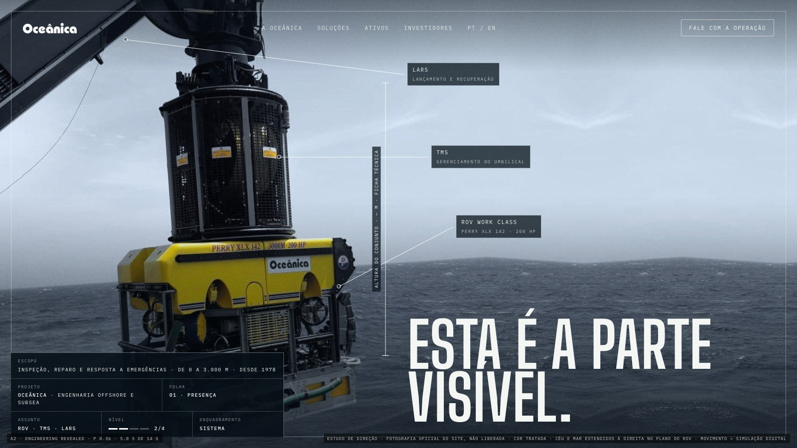

# 05 · Recomendação

Data: 16/11/2026. Opinião de direção criativa. A decisão é sua.

## Recomendo o A2 · Engineering Revealed

Com uma troca: o título passa a ser **"Esta é a parte visível."** e "Escala oceânica." vira o título do ato 02. O quadro `A2/frames/2-alt.jpg` mostra essa combinação.

## Por quê

1. **É o único que resolve o problema desta etapa.** O pedido foi deixar de parecer empresa de navegação. No A2, o primeiro quadro é um equipamento subsea com a marca da Oceânica e "3000 M" impresso nele. Em seis segundos o visitante passou por equipamento, sistema, embarcação e campo.
2. **Entrega as três percepções na ordem pedida.** "É maior do que parece" (do detalhe ao sistema). "Há engenharia ligando tudo" (as chamadas e a linha de visada). "Tem capacidade para operações complexas" (o carimbo com os números e as fontes).
3. **O título ganha um sentido que só existe aqui.** Um ROV suspenso sobre o mar está no último instante em que pode ser visto. "Esta é a parte visível." aponta para os 3.000 m sem mostrar o fundo.
4. **A prova já faz parte da linguagem.** O carimbo de prancha é o lugar natural de número com fonte e data. O ato 02 não precisa inventar contadores.
5. **É o mais viável.** Não exige nenhuma cena que não exista. Lançamento de ROV é rotina e provavelmente já está registrado.
6. **É o mais autoral.** Nenhum dos 16 sites do setor trata fotografia como prancha de engenharia.

## Por que não os outros

**A1.** Tem o primeiro quadro mais forte dos três e a melhor saída para o ato 02. Mas passa seis segundos em um navio e depende de uma tomada junto a uma unidade de produção que não existe e é difícil de conseguir.

**A3.** Tem a revelação mais bonita. Não mostra engenharia, termina em um cais que não sabemos de quem é e só apresenta o título aos 11 segundos.

## O que o A2 perde, e como compensar dentro dele

- **O casco verde quase não aparece.** No storyboard definitivo, o plano do convés deve ser refeito de um ângulo em que o costado verde entre em quadro.
- **Abre em um ROV.** O brief lista "apresentação de um único ROV" como motivo de reprovação. A defesa é o tempo: o ROV fica sozinho por menos de três segundos. Se o recuo for lento, a defesa cai.
- **A camada gráfica pode virar HUD.** Regra para o storyboard: no máximo três chamadas por quadro, uma cota no filme inteiro, nenhum número sem fonte.
- **O último quadro é um nascer do sol.** Decidir, com o material real, entre manter o sol como único amarelo além do ROV ou levar o plano para luz de dia.

## Condições

| Condição | Se não for atendida |
|---|---|
| Original de um lançamento de ROV em resolução plena, de preferência em vídeo | O primeiro quadro fica com a foto de 1834 px: serve em tela média, não em tela grande |
| Fichas técnicas do ROV e da embarcação | As cotas ficam sem valor, e uma cota sem valor deve sair |
| Número único e aprovado de frota e de ROVs | O carimbo mostra os dois valores com a marca "validar", como no estudo. Não vai ao ar assim |
| Confirmação de que o ROV fotografado ainda representa a frota | Trocar por registro atual |

## Questões que precisam de validação

**Suas**

1. O A2 segue para o storyboard de produção, com o título trocado?
2. O projeto sai de `v06/` para `OCEANICA-FLAGSHIP` antes da próxima etapa? (Passos em `01_DIRECTION.md`, seção 1.)
3. Posso usar créditos para um teste de ampliação da foto do ROV e um teste de câmera? Sem a sua resposta, nada é gerado.

**Da Oceânica**

4. Existem vídeos de lançamento de ROV e os originais de 2024? Quem libera?
5. Qual é o número vigente de embarcações (11, 18 ou 19) e de ROVs (55 ou 56)?
6. O Perry XLX 142 da foto está em operação? Pode aparecer com o nome do modelo?
7. A assinatura oficial continua, ou há abertura para uma linha de campanha?

## Próxima etapa, depois da sua escolha

Storyboard de produção definitivo da composição vencedora: plano a plano, com lente, duração, origem de cada asset e versão mobile. Nada de implementação até lá.
