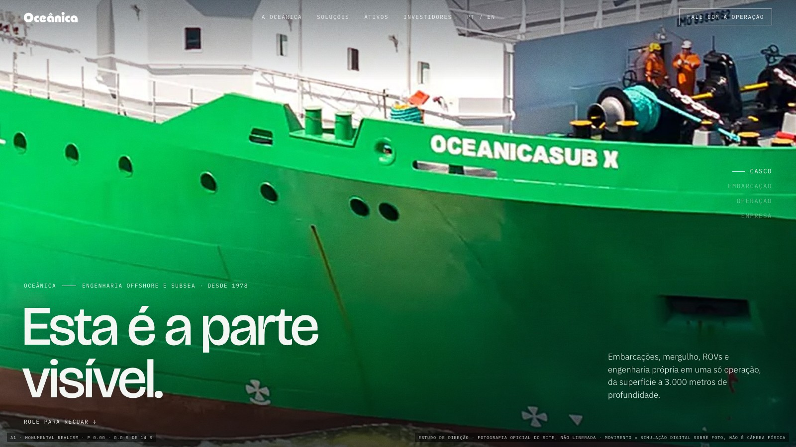
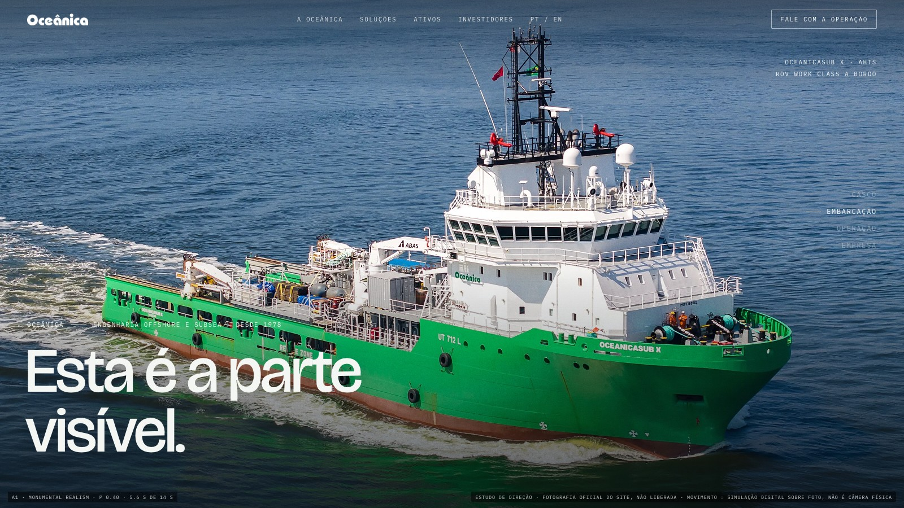
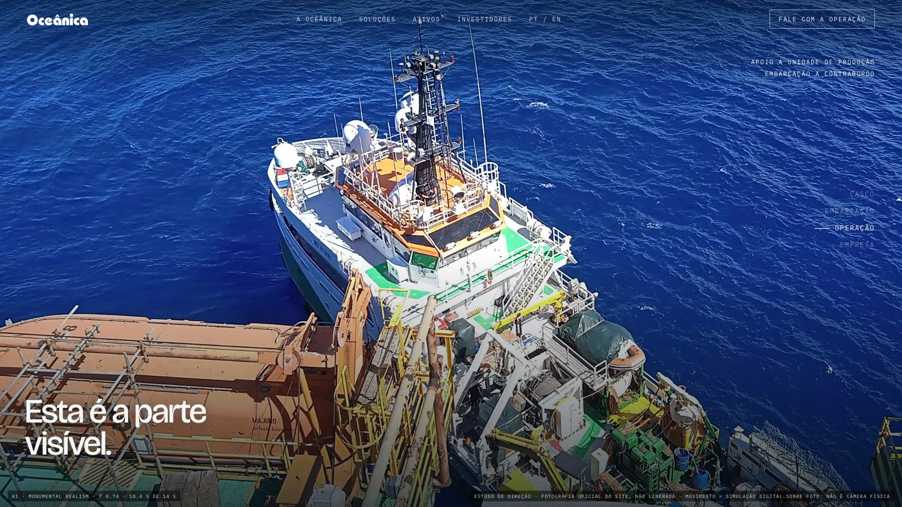
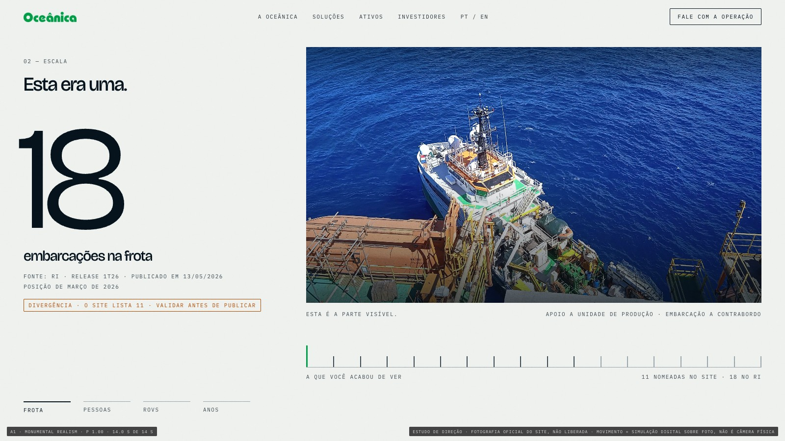

# A1 · Monumental Realism · storyboard

Animatic: `animatic.mp4` (14 s, 1280 × 720) e `index.html` (interativo). Quadros em `frames/`.

Título em estudo: **"Esta é a parte visível."** Fotografias: Oceanicasub X (2024) e apoio a unidade de produção (2021).

| Quadro | Tempo | Imagem | O que acontece |
|---|---|---|---|
| 01 · Hook | 0 s |  | O costado verde passa das bordas. Nome da embarcação e duas pessoas na proa dão a medida. Título já presente |
| 02 · Reveal | 5,6 s |  | O recuo mostra o navio inteiro e a esteira. Legenda: Oceanicasub X, AHTS |
| 03 · Expansion | 10,4 s |  | A embarcação a contrabordo de uma unidade de produção. O título encolhe e vira legenda |
| 04 · Handoff | 14 s |  | O filme encolhe e vira um quadro na página clara. "Esta era uma." e o número da frota, com fonte e divergência |

Mobile (`frames/m.jpg`): composição vertical própria, a proa sobe pela tela. No retrato, o recuo vira subida de drone.

## Câmera entre os quadros

- **01 → 02:** dois segundos parado, depois recuo com subida suave. No estudo, é um reenquadramento de 3,9 para 1,1 vez sobre a mesma foto.
- **02 → 03:** no estudo, um corte curto para outra fotografia. No filme, a mesma tomada continua até a unidade entrar em quadro.
- **03 → 04:** a câmera para. O que recua é a página: o filme passa de tela cheia para 58% da largura, no alto à direita.

## Ritmo

Lento, com peso. Um movimento único de 11 s e uma saída de 3 s. Sem aceleração brusca.

## Luz

Sol alto e lateral, cor natural. Nenhum tratamento além de contraste leve e grão.

## Tipografia

Bricolage Grotesque 500, 112 px, duas linhas, embaixo à esquerda. Mono de 11 px para sobrelinha, legendas e indicador de degrau.

## O que muda e o que fica

| Fica parado | Muda |
|---|---|
| Título (até o quadro 02), navegação, indicador de degrau | Enquadramento, legenda do alto à direita, degrau ativo |
| Posição do título | Tamanho do título (encolhe a partir de 6,6 s) |

## Notas de produção

- A tomada ideal é um voo só, da bochecha do navio até o navio aparecer junto à unidade.
- Aproximação de unidade de produção depende de autorização do operador da unidade.
- Alternativa: duas tomadas com corte em movimento. Perde a continuidade, que é o argumento do tratamento.

## Limitações conhecidas

- Fotografias do site oficial, ainda não liberadas para publicação.
- O movimento é reenquadramento digital sobre foto. Não há paralaxe nem água em movimento.
- Tipografia de estudo (Google Fonts). Licenciar equivalente na produção.
- O macro do quadro 01 está ampliado 2,2 vezes: fica mole em tela grande.
- O quadro 03 mostra outra embarcação, com pintura anterior à atual. Não afirmar que é da frota de hoje.
- "ROV Work Class a bordo" na legenda do quadro 02 vem da página da embarcação no site; confirmar.
- O número 18 e o 11 aparecem lado a lado de propósito. Não foi feita escolha.
