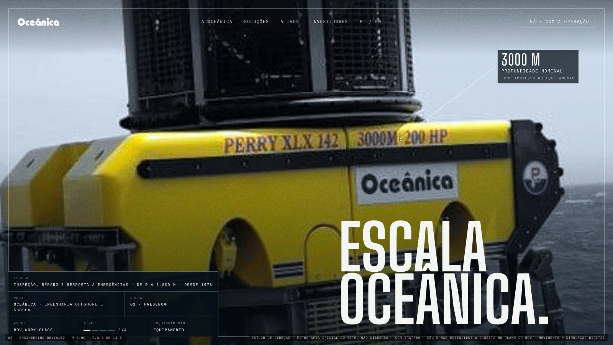
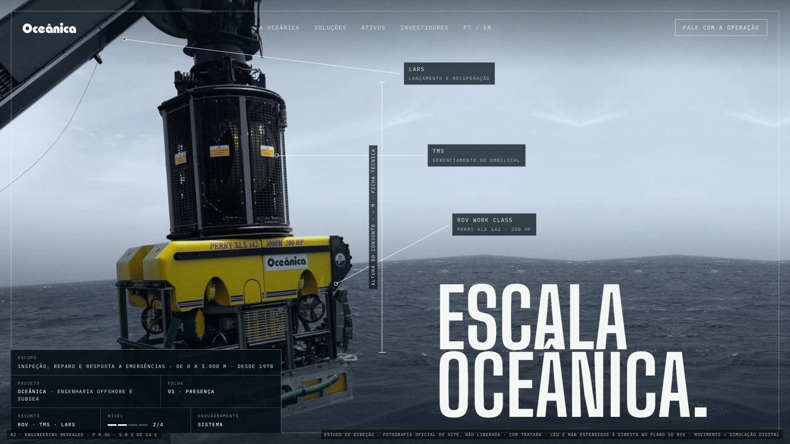
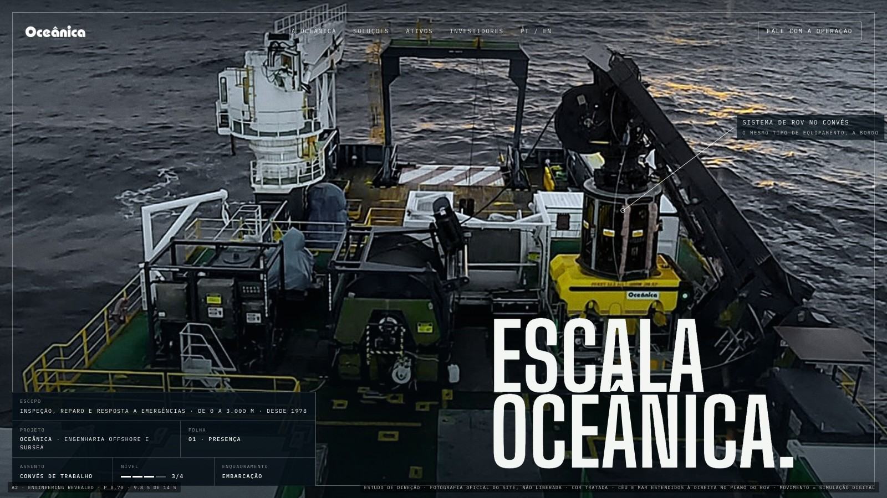
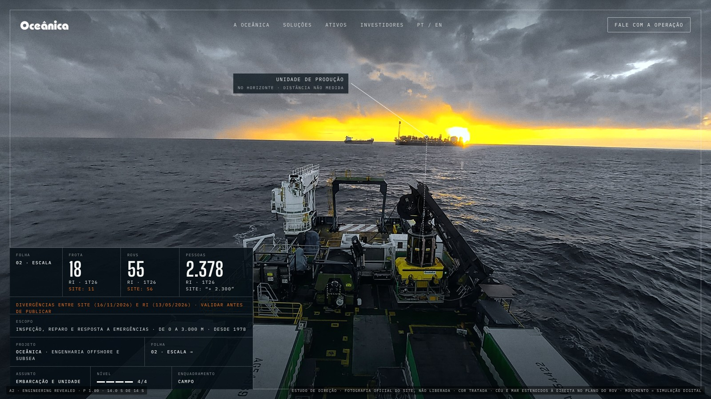

# A2 · Engineering Revealed · storyboard

Animatic: `animatic.mp4` (14 s, 1280 × 720) e `index.html` (interativo). Quadros em `frames/`.

Título em estudo: **"Escala oceânica."** Alternativa recomendada no mesmo enquadramento: `frames/2-alt.jpg`, com "Esta é a parte visível." (abra `index.html?h=alt` para ver em movimento). Fotografias: ROV Work Class em lançamento e convés ao amanhecer.

| Quadro | Tempo | Imagem | O que acontece |
|---|---|---|---|
| 01 · Hook | 0 s |  | Macro do ROV. Uma única chamada: "3000 M", como está impresso no equipamento. Carimbo: nível 1/4, equipamento |
| 02 · Reveal | 5 s |  | O conjunto inteiro suspenso sobre o mar. Três chamadas (LARS, TMS, ROV) e a única cota do filme. Nível 2/4, sistema |
| 03 · Expansion | 9,8 s |  | Corte por semelhança: o mesmo tipo de ROV, estivado no convés. Nível 3/4, embarcação |
| 04 · Handoff | 14 s |  | O recuo mostra o convés e a unidade de produção no horizonte, ligados por uma linha de visada. O carimbo abre e vira a folha 02, com frota, ROVs e pessoas, cada número com a fonte |

Mobile (`frames/m.jpg`): o ROV suspenso é vertical por natureza e ocupa o retrato inteiro. O carimbo fica reduzido a uma linha de escopo; as chamadas saem.

## Câmera entre os quadros

- **01 → 02:** recuo reto, sem subida, com zoom abrindo. No estudo, de 3,3 para 1,1 vez.
- **02 → 03:** corte seco aos 6 s. O amarelo do ROV suspenso é substituído pelo amarelo do ROV no convés, na mesma região do quadro.
- **03 → 04:** recuo e subida até o horizonte entrar.

## Ritmo

Constante. É o mais contido dos três. As chamadas entram depois que a câmera assenta, nunca durante o movimento rápido.

## Luz e cor

Luz difusa. O mundo em cinza de aço; só o verde da marca e o amarelo do equipamento guardam cor. No último quadro, o sol do horizonte cai na mesma faixa de amarelo.

## Tipografia

Big Shoulders Display 700, caixa alta, 164 px, duas linhas, embaixo à direita. Mono de 11 px nas chamadas e no carimbo.

## O que muda e o que fica

| Fica parado | Muda |
|---|---|
| Moldura da folha, carimbo, título, navegação | Fotografia, chamadas, campos "assunto", "nível" e "enquadramento" do carimbo |
| Posição de tudo | O carimbo cresce no último segundo e meio |

## Regras da camada gráfica

1. Toda chamada está presa a um ponto real da imagem e se move com ele.
2. No máximo três chamadas por quadro.
3. Uma cota no filme inteiro. Sem valor verificado, a cota sai.
4. Nenhum número sem fonte e data.

## Notas de produção

- O ROV contra o céu recorta limpo; a máscara já existe em `media-src/rov-launch-mask.png` (repositório antigo). É o único caso em que 2.5D é honesto: ROV recortado sobre vídeo real de mar.
- O plano do convés deve ser refeito de um ângulo em que o costado verde apareça.
- Conferir com a engenharia os nomes das chamadas (LARS, TMS).

## Limitações conhecidas

- Fotografias do site oficial, ainda não liberadas para publicação.
- O movimento é reenquadramento digital sobre foto. Não há paralaxe nem água em movimento.
- Tipografia de estudo (Google Fonts). Licenciar equivalente na produção.
- A foto do ROV tem 1834 px. O macro está ampliado 1,7 vez.
- **Céu e mar foram estendidos à direita** no plano do ROV, por espelhamento. Há repetição visível nas ondas. É recurso de estudo.
- A cor foi tratada: não é a cor da cena.
- "Altura do conjunto" está sem valor: as fichas técnicas não foram abertas.
- A unidade no horizonte não está identificada, e a distância não foi medida.
- Não confirmei que o ROV da foto (Perry XLX 142) está em operação hoje.
- 55 e 56 ROVs, 18 e 11 embarcações aparecem lado a lado de propósito.
