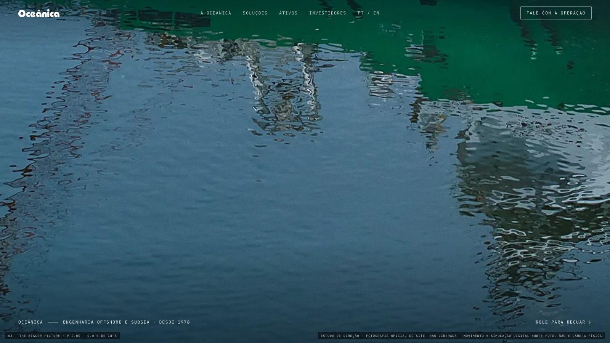
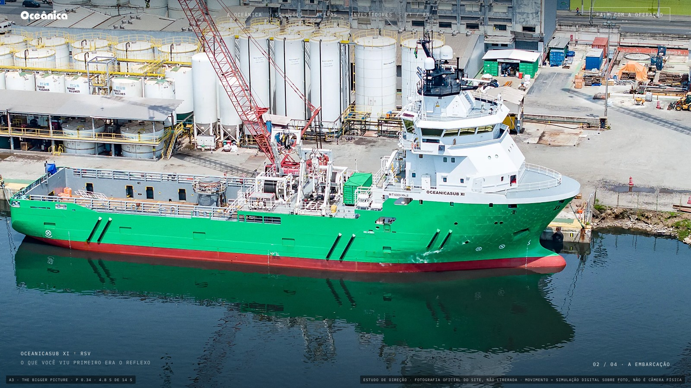
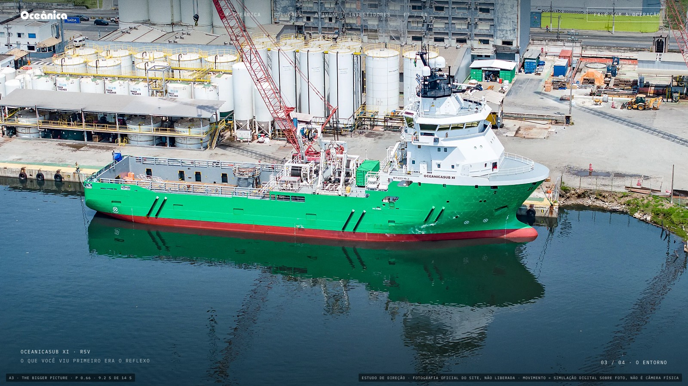
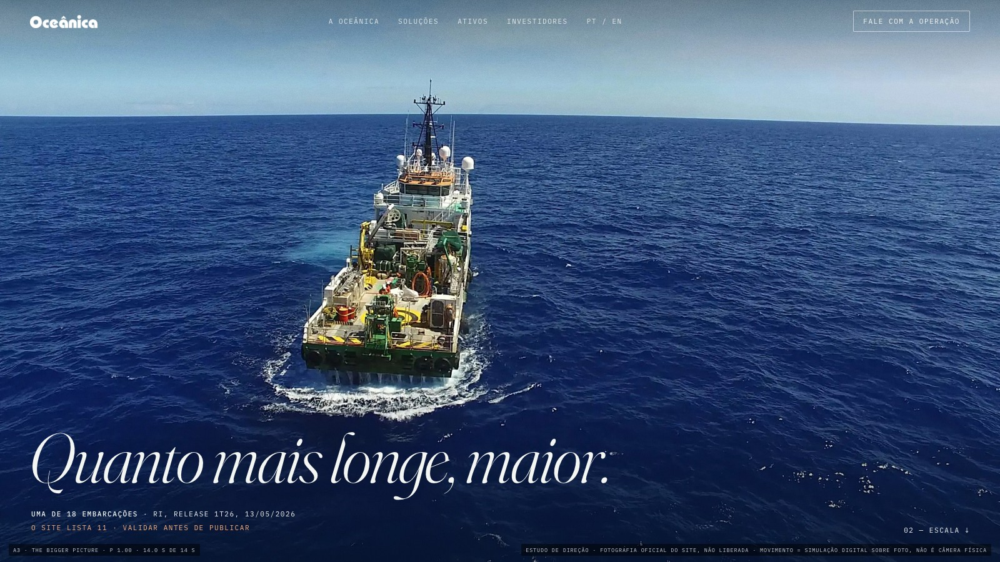

# A3 · The Bigger Picture · storyboard

Animatic: `animatic.mp4` (14 s, 1280 × 720) e `index.html` (interativo). Quadros em `frames/`.

Título em estudo: **"Quanto mais longe, maior."** Fotografias: Oceanicasub XI no cais (2024) e embarcação em mar aberto (2021).

| Quadro | Tempo | Imagem | O que acontece |
|---|---|---|---|
| 01 · Hook | 0 s |  | Curiosidade. Água, manchas verdes e brancas. Não se sabe o que é nem de que tamanho. Só a sobrelinha da marca |
| 02 · Reveal | 4,8 s |  | Revelação. A câmera sobe e o casco aparece acima do próprio reflexo. Legenda: Oceanicasub XI, RSV |
| 03 · Expansion | 9,2 s |  | O entorno: cais, guindaste, tanques |
| 04 · Handoff | 14 s |  | Admiração. Corte seco para o mar aberto. O título entra em uma linha. Prova: "Uma de 18 embarcações", com fonte e divergência |

Mobile (`frames/m.jpg`): o eixo vertical entre navio e reflexo organiza o retrato. É o tratamento que melhor se adapta ao celular.

## Câmera entre os quadros

- **01 → 02:** um gesto de grua: inclina para cima, sobe e recua. No estudo, de 2,9 para 1,2 vez, com o centro subindo.
- **02 → 03:** o mesmo gesto continua até o quadro inteiro da foto.
- **03 → 04:** corte seco aos 9,8 s, do abrigo para o oceano. Depois, recuo lento até o fim.

## Ritmo

Lento no reflexo, mais solto depois do reconhecimento. O corte é o único acento.

## Luz

Sol alto, água calma, turquesa e verde. No corte, azul profundo.

## Tipografia

Fraunces 300 em itálico, 112 px, uma linha, só no último quadro. Antes, mono de 11 px.

## O que muda e o que fica

| Fica parado | Muda |
|---|---|
| Navegação | Tudo o mais |
| — | O título só existe no fim |

## Notas de produção

- Fácil de captar: porto, água calma, voo baixo. Não depende de terceiros.
- O reflexo precisa se mover. Com foto parada, o truque aparece.
- O último plano deve ser refeito com uma embarcação de casco atual.

## Limitações conhecidas

- Fotografias do site oficial, ainda não liberadas para publicação.
- O movimento é reenquadramento digital sobre foto. Não há paralaxe nem água em movimento.
- Tipografia de estudo (Google Fonts). Licenciar equivalente na produção.
- O local do cais não está identificado. O nome do arquivo sugere um estaleiro em Niterói; não confirmei.
- O entorno não é operação offshore.
- A embarcação do último quadro tem pintura anterior e não está identificada.
- A primeira tela não tem título. Em um site, isso pesa em clareza e em busca.
