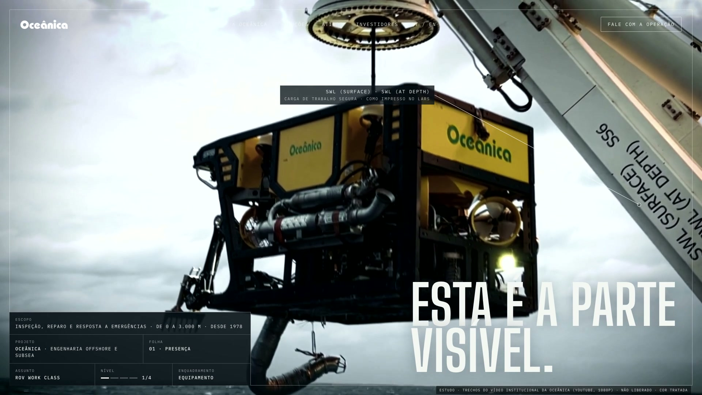
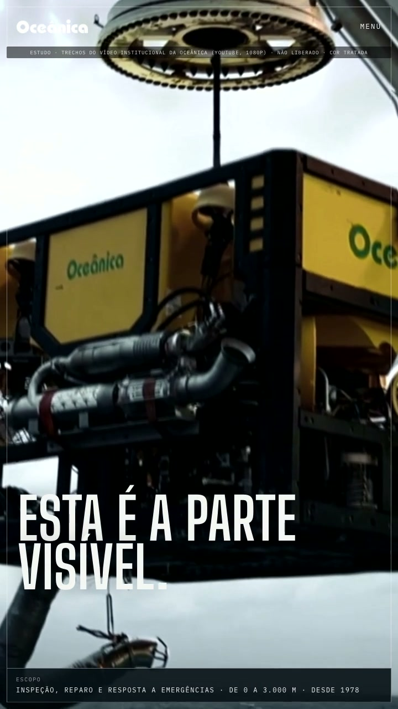
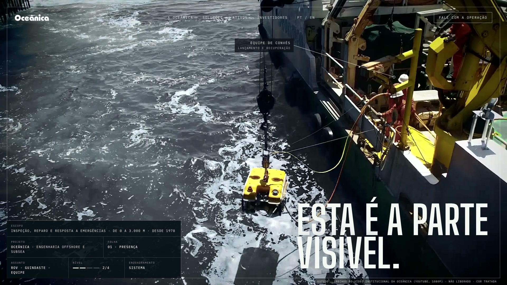
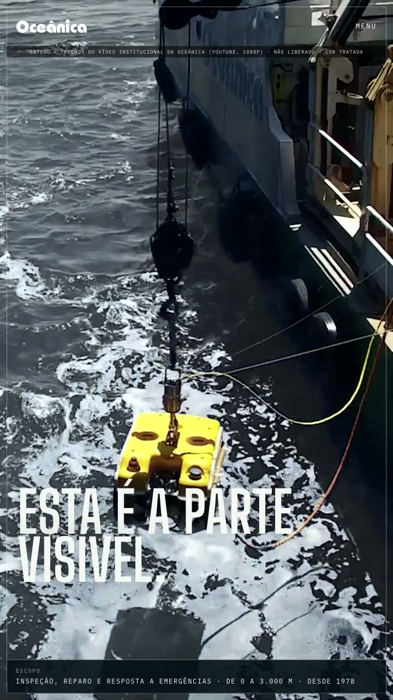
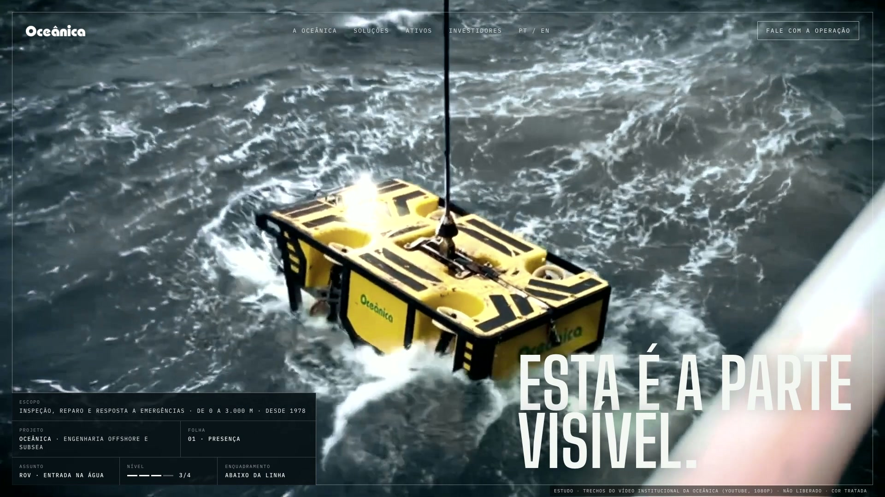
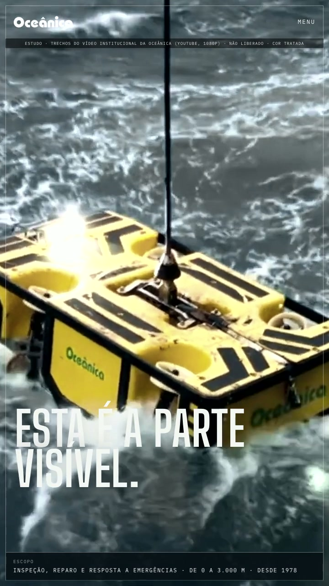
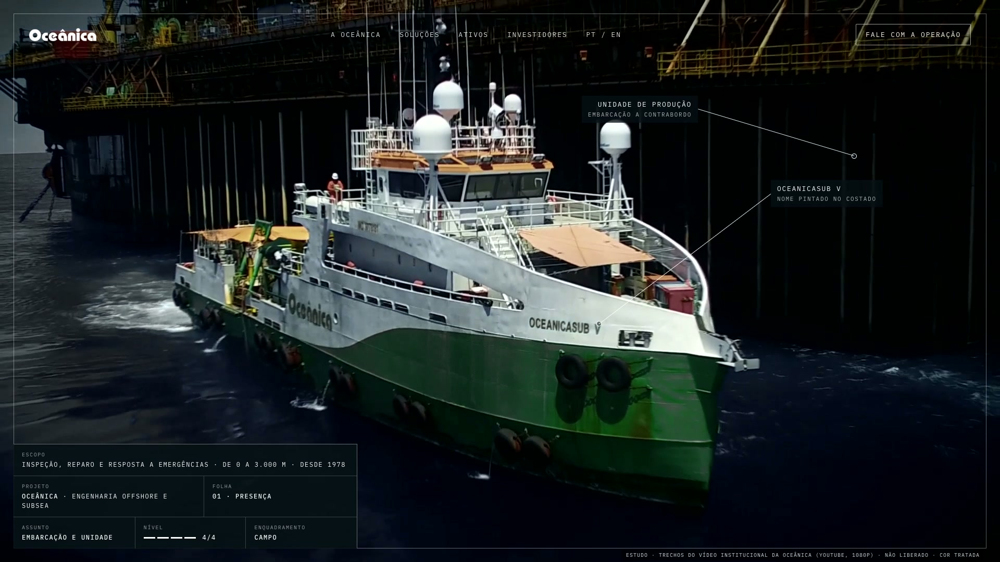
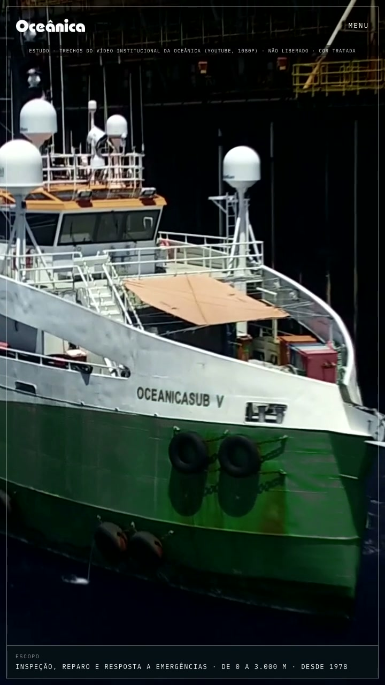
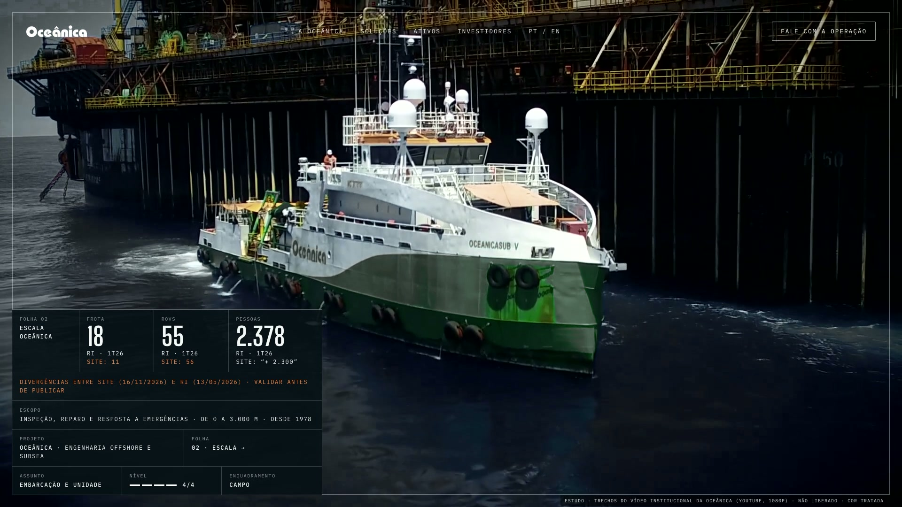
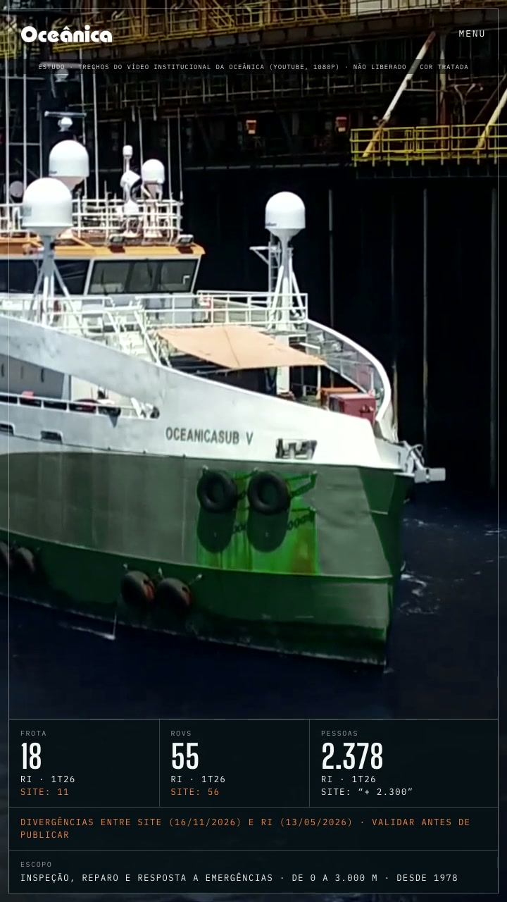

# Hero · storyboard de produção · versão 2

Data: 16/11/2026. Aprovado como base: tratamento **A2 · Engineering Revealed**, título **"Esta é a parte visível."**, montagem **60 → 72 → 32 → 34** do vídeo institucional.

A versão 1 (sobre fotografias do site, com recuo simulado) está preservada em `PRODUCTION_STORYBOARD_v1.md`.

Cobre o ato 01 (Presença) e a entrega para o ato 02 (Escala). Não é implementação: é o roteiro que a produção de mídia e a Fase 4 vão seguir.

| Arquivo | O que é |
|---|---|
| `real-footage/animatic-real.mp4` | Animatic de 19 s, 1920 × 1080 |
| `real-footage/animatic-real-mobile.mp4` | Animatic de 19 s, 720 × 1280 |
| `real-footage/frames/` | Quadros-chave desktop (1–5) e mobile (m1–m5) |
| `real-footage/overlay.html`, `build.sh` | Camada gráfica e montagem, para refazer o animatic |
| `../references/institutional-video/SHOT_LIST.md` | Shot list completa do vídeo |

**Situação do material:** todos os planos vêm de uma cópia do YouTube, não liberada. O animatic serve para decidir; a versão final depende dos brutos (seção 8).

---

## 1. A ideia, em uma linha

**Cada plano é mais aberto que o anterior, e o carimbo marca o degrau:** equipamento → sistema → abaixo da linha → campo. O recuo, que na versão 1 era um movimento de câmera, passa a ser montagem.

---

## 2. A sequência

| | Desktop | Mobile | O que o visitante entende |
|---|---|---|---|
| **01 · Equipamento** · 0 s |  |  | Uma máquina de trabalho, da Oceânica, com especificação de engenharia impressa |
| **02 · Sistema** · 3,4 s |  |  | A máquina é parte de um sistema: guindaste, cabos, equipe, embarcação |
| **03 · Abaixo da linha** · 7,6 s |  |  | A máquina vai para onde não se vê. É a parte visível acabando |
| **04 · Campo** · 11,9 s |  |  | A embarcação trabalha junto a uma unidade de produção |
| **05 · Folha 02** · 15 s |  |  | E a empresa tem muitas iguais: entra a prova, com fonte |

---

## 3. Plano a plano

Tempos de origem referem-se a `assets/reference/oceanica-institucional-yt-qzGU8XxzSTI-1080p.mp4`.

### Plano 1 · ROV no LARS · plano 60 do vídeo

| | |
|---|---|
| Origem | 2:21.56 – 2:23.85 (2,29 s limpos) |
| Na hero | 0 – 3,4 s. Desacelerado 1,5 vez |
| Imagem | ROV Work Class suspenso contra o céu, marca "Oceânica" em duas faces. Braço do LARS à direita com "SWL (SURFACE) · SWL (AT DEPTH)" impresso |
| Câmera | Fixa, de baixo. O ROV oscila no cabo |
| Gráfico | Título. Carimbo 1/4 · Equipamento. Uma chamada presa à inscrição do LARS |
| Recorte mobile | x = 690 de 1920 (608 px de largura). O ROV fica inteiro; a inscrição do LARS sai |
| Primeiro quadro | É também o pôster de carregamento |
| Pedir no bruto | O take inteiro. 2,3 s não sustentam um scroll lento |

### Plano 2 · Recuperação junto ao costado · plano 72

| | |
|---|---|
| Origem | 2:49.04 – 2:53.24 (dos 7,38 s limpos, usar os primeiros 4,2 s) |
| Na hero | 3,4 – 7,6 s. Velocidade real |
| Imagem | Drone sobre o costado: ROV de observação na água, guindaste, equipe de laranja, casco |
| Câmera | Aérea, quase fixa. O ROV sobe (é uma recuperação) |
| Gráfico | Título. Carimbo 2/4 · Sistema. Uma chamada na equipe de convés |
| Recorte mobile | x = 740. ROV e cabos ficam; a equipe sai do quadro |
| Atenção | É outro ROV (de observação), menor que o do plano 1. Não sugerir que é o mesmo |
| Pedir no bruto | Se existe o mesmo ângulo num lançamento (ROV descendo) |

### Plano 3 · O ROV entra na água · plano 32

| | |
|---|---|
| Origem | 1:25.96 – 1:30.30 (4,34 s limpos) |
| Na hero | 7,6 – 11,9 s. Velocidade real |
| Imagem | De cima, o ROV Work Class amarelo entra na água e some na espuma. Marca legível |
| Câmera | Fixa, da amurada |
| Gráfico | Título. Carimbo 3/4 · Abaixo da linha. Sem chamada: o momento é da imagem |
| Recorte mobile | x = 660 |
| Atenção | É o único plano que fecha o quadro em relação ao anterior. Existe para dar ao título o seu momento |
| Pedir no bruto | Confirmar se este ROV é o mesmo do plano 1. Se for, o corte 1 → 3 vira continuidade de personagem |

### Plano 4 · Oceanicasub V junto ao FPSO · plano 34

| | |
|---|---|
| Origem | 1:34.26 – 1:39.0 (cerca de 4,7 s limpos; glitch de saída depois) |
| Na hero | 11,9 – 19,1 s. Desacelerado 1,25 vez e 1,2 s parado no fim |
| Imagem | Casco verde, "Oceânica" e "OCEANICASUB V" pintados, costado do FPSO ao fundo, luz de dia |
| Câmera | Aérea, quase fixa |
| Gráfico | Título sai na entrada. Carimbo 4/4 · Campo. Chamadas no nome do navio e na unidade. Aos 3 s do plano, a folha 02 abre |
| Recorte mobile | x = 800. Nome do navio e proa ficam |
| Alternativa melhor | Plano 26 (1:09.49 – 1:13.03): mesma cena, mais aberta, com o topo do FPSO. Só serve com o original sem letreiro |
| Pedir no bruto | O plano 26 sem texto e o take inteiro do voo |

---

## 4. Linha do tempo e scroll

Duração: 19 s de filme, amarrados ao scroll em cerca de **quatro alturas de tela**. O scroll nunca fica preso.

| Scroll | Tempo | Plano | Corte |
|---|---|---|---|
| 0 – 18% | 0 – 3,4 s | 1 · Equipamento | — |
| 18 – 40% | 3,4 – 7,6 s | 2 · Sistema | Seco |
| 40 – 62% | 7,6 – 11,9 s | 3 · Abaixo da linha | Seco |
| 62 – 100% | 11,9 – 19,1 s | 4 · Campo e folha 02 | Seco |

Regras:

- **Cortes secos.** Nada de fusão, glitch ou efeito: o vídeo de origem já tem efeitos demais.
- **O título fica parado** dos planos 1 a 3 e sai no corte para o plano 4.
- **Nenhuma chamada entra no primeiro meio segundo de um plano.**
- **O carimbo muda de nível no corte,** nunca durante o plano.

---

## 5. Camada gráfica

Mantém as regras da versão 1 (seção 5 de `PRODUCTION_STORYBOARD_v1.md`), com três diferenças:

| | Versão 1 | Versão 2 |
|---|---|---|
| Níveis | Equipamento · Sistema · Embarcação · Campo | Equipamento · Sistema · **Abaixo da linha** · Campo |
| Cota | Uma, a altura do conjunto, se a ficha trouxer o valor | **Nenhuma.** A chamada do LARS faz o papel de dado de engenharia, e é verdadeira |
| Chamadas | Presas a pontos de uma foto | Presas a pontos de vídeo. Nos planos 1 e 4 a câmera é quase fixa; na produção, rastrear o ponto se houver deriva |

Limites que continuam: no máximo três chamadas por quadro, nenhum número sem fonte e data, nada de retícula ou medidor.

**Cor:** azuis e cianos vão para cinza de aço; o verde da marca e o amarelo do equipamento ficam. No animatic, a correção foi aplicada por cima da cor já tratada do vídeo. Com os brutos, aplicar a partir do log.

---

## 6. Texto

| Onde | Português | Inglês |
|---|---|---|
| Título | Esta é a parte visível. | This is the visible part. |
| Chamada, plano 1 | SWL (surface) · SWL (at depth) · Carga de trabalho segura · como impresso no LARS | SWL (surface) · SWL (at depth) · Safe working load · as printed on the LARS |
| Chamada, plano 2 | Equipe de convés · Lançamento e recuperação | Deck crew · Launch and recovery |
| Chamadas, plano 4 | Oceanicasub V · Nome pintado no costado / Unidade de produção · Embarcação a contrabordo | Oceanicasub V · Name on the hull / Production unit · Vessel alongside |
| Níveis | Equipamento · Sistema · Abaixo da linha · Campo | Equipment · System · Below the line · Field |
| Escopo | Inspeção, reparo e resposta a emergências · de 0 a 3.000 m · desde 1978 | Inspection, repair and emergency response · 0 to 3,000 m · since 1978 |
| Folha 02 | Escala oceânica | Oceanic scale |
| Botão | Fale com a operação | Talk to operations |

A acrescentar na Fase 4: indicação discreta de scroll no primeiro quadro.

---

## 7. Mobile, carregamento e acessibilidade

- **Mobile:** recorte vertical próprio de cada plano (seção 3). No mobile saem as chamadas e as linhas de projeto e assunto do carimbo; ficam título, escopo e, no fim, os três números.
- **O recorte vertical de um 1080p dá 608 px de largura,** ampliados para 720. Em celulares de tela densa isso fica mole. Com brutos em 4K, o recorte vertical passa a ter resolução própria.
- **Primeiro quadro:** imagem estática do plano 1, com título e carimbo em HTML. O vídeo assume depois de carregado.
- **Movimento reduzido:** os quatro quadros-chave parados, em fusão, com o mesmo texto e a mesma ordem.
- **Tema claro e escuro:** governa navegação e atos editoriais. A hero mantém a sua cor nos dois.
- **Sem JavaScript:** o primeiro quadro e o texto.

---

## 8. Entregáveis de mídia

| Item | Especificação proposta | Origem |
|---|---|---|
| Brutos dos planos 60, 72, 32, 34 e 26 | Resolução e codec da captação, sem letreiro, sem cor, takes inteiros | Oceânica ou produtora |
| Versão horizontal da hero | 1920 × 1080 mínimo; 2560 × 1440 se o bruto permitir | Montagem a partir dos brutos |
| Versão vertical | 1080 × 1920, recortada de bruto 4K | Idem |
| Pôster | Quadro do plano 1, sem gráfico, em AVIF e JPEG | Idem |
| Quadros de movimento reduzido | Quatro quadros-chave | Idem |

Formato para o scroll (vídeo com quadros-chave densos ou sequência de imagens) é decisão da Fase 4, com medição. Não está fechado aqui.

**Se os brutos não existirem:** ampliar os trechos do YouTube. Exige créditos e a sua autorização, e a palavra "Oceânica" no ROV tem de ser conferida letra a letra.

---

## 9. Entrega para o ato 02

Sem mudança em relação à versão 1. A folha 02 abre no fim do plano 4 com frota, ROVs e pessoas, cada valor com fonte e com a divergência ao lado:

| | RI, release 1T26 (13/05/2026) | Site (16/11/2026) |
|---|---|---|
| Embarcações | 18 | 11 nomeadas |
| ROVs | 55 | 56 |
| Pessoas | 2.378 | "+ 2.300" |

**Não vai ao ar assim.** Precisa de um número único e datado, aprovado pela Oceânica. O ato 02 em si não foi desenhado.

---

## 10. O que pedir à Oceânica

1. Os brutos do vídeo institucional (YouTube `qzGU8XxzSTI`), sem letreiros e sem cor, em especial 1:09–1:40 e 2:21–2:57. Os takes inteiros, não só o trecho montado.
2. O contato da produtora e se há mais material da mesma captação.
3. Se o ROV dos planos 60 e 32 é o mesmo equipamento, e qual o modelo.
4. Os números vigentes de embarcações, ROVs e pessoas, com data.
5. Autorização de uso de imagem, com escopo e prazo.
6. Quem aprova, e em quanto tempo.

---

## 11. Decisões em aberto

| Decisão | De quem |
|---|---|
| Plano 4 com o 34 (pronto) ou com o 26 (melhor, depende do original) | Sua, depois da resposta da Oceânica |
| Uso de créditos para ampliação, se não houver brutos | Sua |
| Mover o projeto para `OCEANICA-FLAGSHIP` | Sua |
| Números oficiais | Oceânica |

---

## 12. Limitações conhecidas

- O material é uma cópia do YouTube não liberada, com compressão, vinheta e cor embutidas.
- No animatic, o plano 1 foi desacelerado com quadros misturados: há fantasma leve no movimento.
- O plano 2 é uma recuperação, e não um lançamento.
- O recorte mobile, a partir de 1080p, fica abaixo da resolução de telas densas.
- O áudio do vídeo não foi analisado; a hero, por ora, não tem som previsto.
- Tipografia de estudo (Big Shoulders Display e IBM Plex Mono). Licenciar equivalentes.
