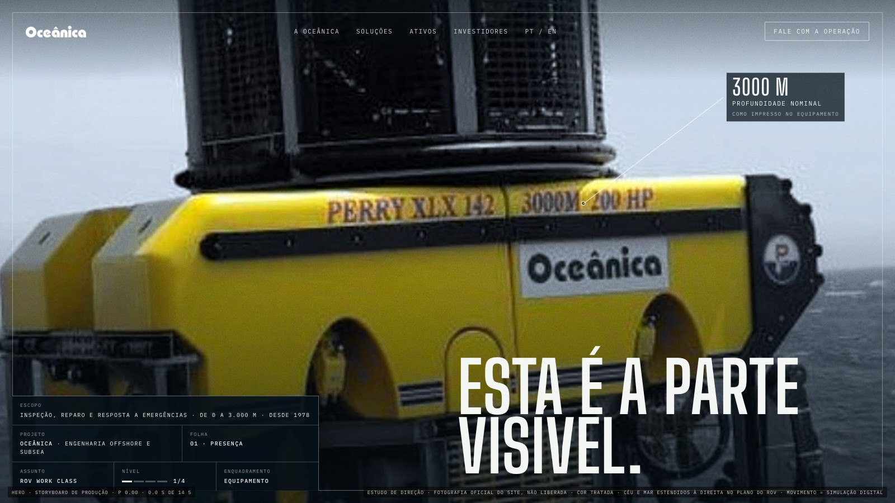
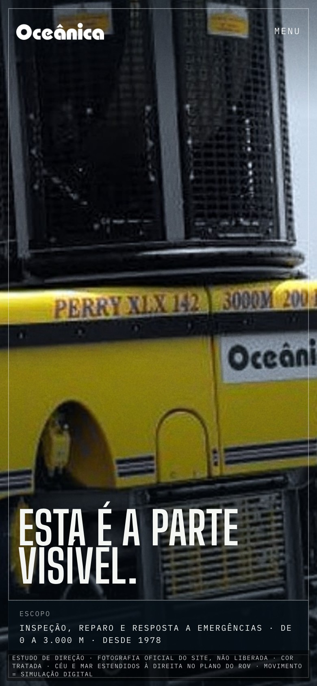
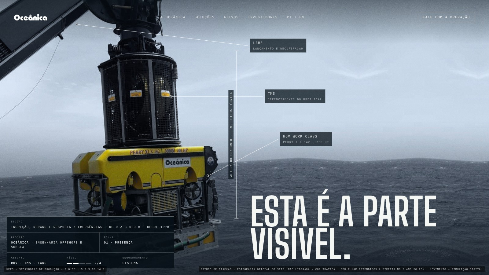
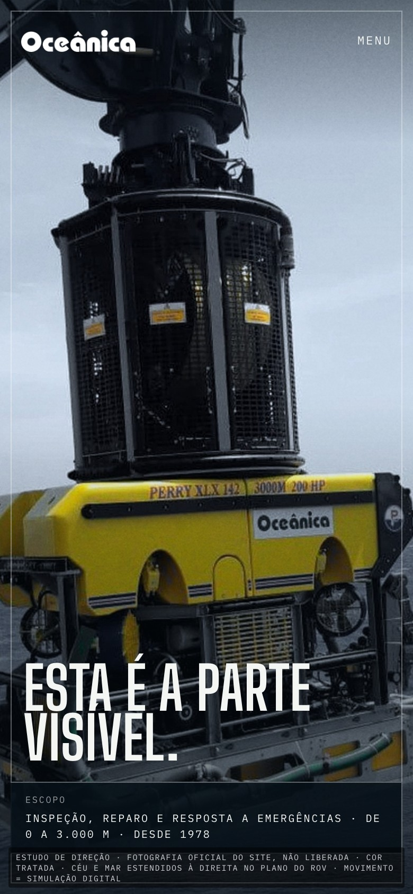
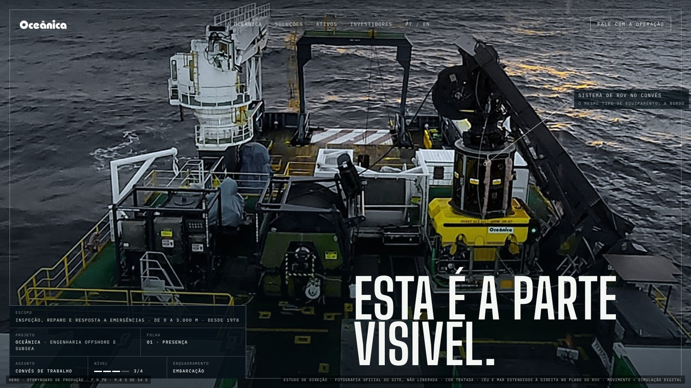
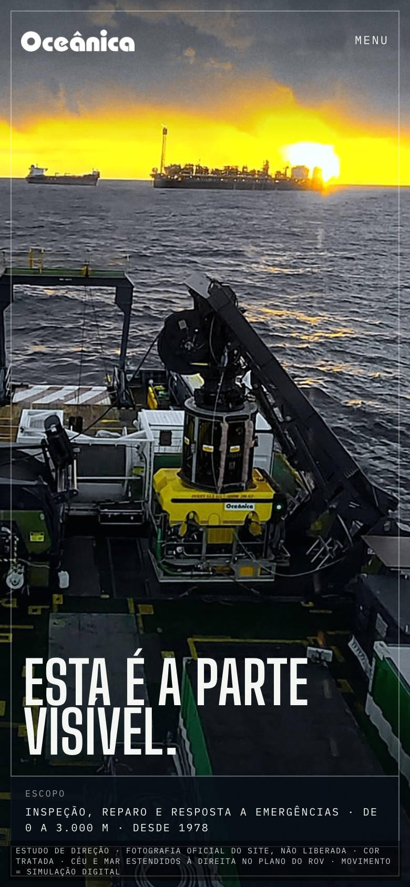
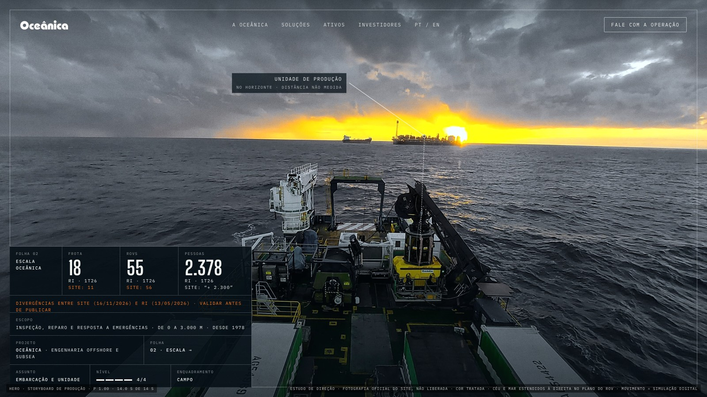
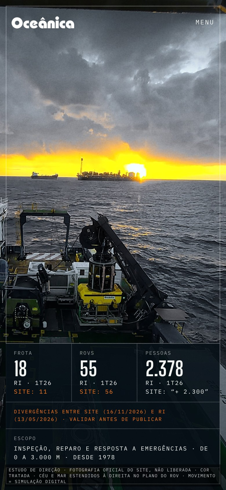

<!-- Versão 1, preservada em 16/11/2026: storyboard sobre fotografias do site, antes do vídeo institucional. Não editar. -->
# Hero · storyboard de produção

Data: 16/11/2026. Direção escolhida: **A2 · Engineering Revealed**, com o título **"Esta é a parte visível."**

Cobre o ato 01 (Presença) e a entrega para o ato 02 (Escala). Não é implementação: é o roteiro que a produção de mídia e a Fase 4 vão seguir.

Arquivos desta pasta: `index.html` (animatic interativo), `animatic.mp4` (14 s), `frames/1–4.jpg` (desktop), `frames/m1–m4.jpg` (mobile). Os estudos anteriores continuam intactos em `../hero-refinement/`.

**O que os quadros são:** composições sobre fotografias do site oficial, ainda não liberadas, com cor tratada e céu e mar estendidos no plano do ROV. O movimento é reenquadramento digital. Lente, duração e formato de entrega abaixo são **propostas de direção**, a confirmar com quem for filmar e com quem for implementar.

---

> **Atualização, 16/11/2026:** o vídeo institucional da Oceânica tem planos reais para os quatro quadros (ROV suspenso no LARS, lançamento visto de cima, casco verde junto a FPSO). Ver `../references/institutional-video/SHOT_LIST.md`, seção 4. Este storyboard ainda não foi refeito com eles.

## 1. O que mudou em relação ao estudo A2

| Item | Estudo A2 | Agora |
|---|---|---|
| Título | "Escala oceânica." | "Esta é a parte visível.", 126 px, duas linhas |
| "Escala oceânica" | Título da hero | Nome da folha 02 no carimbo: é o título do ato 02 |
| Mobile | Um quadro | Quatro quadros, com enquadramento próprio em cada plano |
| Prova no mobile | Ausente | O carimbo abre no último quadro, com frota, ROVs e pessoas |

---

## 2. A sequência

| | Desktop | Mobile | O que o visitante entende |
|---|---|---|---|
| **01 · Hook** · 0 s |  |  | É uma máquina de trabalho, é da Oceânica, vai a 3.000 m |
| **02 · Reveal** · 5 s |  |  | A máquina é parte de um sistema, e está prestes a sumir na água |
| **03 · Expansion** · 9,8 s |  |  | O sistema é parte de uma embarcação preparada para isso |
| **04 · Handoff** · 14 s |  |  | A embarcação é parte de um campo. E a empresa tem muitas iguais |

---

## 3. Linha do tempo

Tempo conceitual de 14 s, amarrado ao scroll em cerca de três alturas de tela. O scroll nunca fica preso.

| Tempo | Scroll | Câmera | Texto e gráfico |
|---|---|---|---|
| 0 – 0,7 s | 0 – 5% | Parada no macro | Título, carimbo (nível 1/4) e a chamada "3000 M" já presentes. É o quadro de carregamento |
| 0,7 – 5 s | 5 – 36% | Recuo reto, abrindo a lente | "3000 M" sai aos 2,2 s. Nível passa a 2/4 aos 2,8 s. LARS, TMS e ROV entram aos 3,9 s, com a câmera já lenta. Cota de altura aos 4,2 s |
| 5 – 6 s | 36 – 43% | Assenta no plano aberto | Chamadas saem |
| 6 s | 43% | **Corte por semelhança** | O amarelo do ROV suspenso dá lugar ao amarelo do ROV no convés, na mesma região do quadro. Nível 3/4 |
| 6 – 9,8 s | 43 – 70% | Recuo sobre o convés | "Sistema de ROV no convés" entra aos 7,8 s |
| 9,8 – 12 s | 70 – 86% | Recuo com subida até o horizonte | Chamada sai aos 11,2 s. Nível 4/4 aos 11,8 s. Título sai aos 12 s |
| 12 – 14 s | 86 – 100% | Chega devagar | Linha de visada e "Unidade de produção". O carimbo abre: folha 02, Escala oceânica |

Regra de ritmo: **nenhuma chamada entra enquanto a câmera está rápida.**

---

## 4. Planos a produzir

São dois planos de câmera. O segundo cobre os quadros 03 e 04.

### Plano 1 · Da inscrição ao sistema

| | |
|---|---|
| Função | Abrir com um equipamento subsea real e mostrar que ele é parte de um conjunto |
| Início | Macro do flutuador amarelo: inscrição do modelo, "3000M 200 HP" e a etiqueta da marca. O bloco passa das bordas |
| Fim | ROV, TMS e lança do LARS inteiros, no terço esquerdo. Céu e mar livres à direita, onde fica o título |
| Lente | Longa no início, perto de 100 mm, abrindo até perto de 35 mm. Zoom óptico combinado com recuo |
| Movimento | Recuo reto, horizontal, sem subida. Sem balanço perceptível |
| Duração | 6 s na tela. Captar pelo menos o dobro, em 50 ou 60 quadros por segundo, para o scroll poder andar devagar |
| Luz | Céu encoberto ou sol alto filtrado. Sem contraluz |
| Momento | ROV suspenso, parado ou descendo devagar, antes de tocar a água |
| **Origem, em ordem de preferência** | 1. Vídeo de arquivo da Oceânica de um lançamento de ROV Work Class. 2. Captação dedicada em um lançamento de rotina, do convés e por drone. 3. Fotografia original em resolução plena, com o ROV recortado sobre vídeo real de mar (2.5D). 4. A cópia atual do site, só como pôster |
| Risco de autenticidade | Baixo em 1 e 2. Médio em 3: o fundo deixa de ser o da foto, e isso precisa ser validado pela Oceânica |
| Não fazer | Ampliar a foto com IA sem conferir a inscrição letra a letra. Gerar o movimento e publicar como registro |

### Plano 2 · Do convés ao campo

| | |
|---|---|
| Função | Mostrar o mesmo tipo de equipamento a bordo e, em seguida, a relação da embarcação com uma unidade de produção |
| Início | Fechado no ROV estivado, com o amarelo na mesma região do quadro em que o plano 1 terminou |
| Meio (quadro 03) | Convés de trabalho visto de cima e de popa. Horizonte fora de quadro |
| Fim (quadro 04) | Convés no terço inferior, mar no meio, unidade de produção no horizonte |
| Lente | Grande-angular moderada, perto de 24 mm. Menos distorção que a foto atual |
| Movimento | Recuo com subida contínua. O horizonte entra por cima |
| Duração | 8 s na tela. Captar pelo menos o dobro |
| Luz | **Decisão em aberto.** A foto atual é um nascer do sol, e o tratamento de cor deixa o sol como único amarelo além do ROV. A alternativa é luz de dia, mais coerente com o plano 1 |
| **Origem, em ordem de preferência** | 1. Vídeo de arquivo de convés com unidade à vista. 2. Captação dedicada, por drone a partir da própria embarcação. 3. A fotografia atual (2200 px), que sustenta o enquadramento mas não o movimento |
| Correção pedida na recomendação | Escolher um ângulo em que o **costado verde** entre em quadro. Na foto atual o verde só aparece nos contêineres e na pintura do convés |
| Risco de autenticidade | Baixo. É uma cena que existe |
| Atenção | Voo próximo de unidade de produção depende de autorização do operador. Aqui a unidade fica longe, no horizonte, o que reduz essa dependência |

### O corte

O corte entre os planos é declarado. Não tenta parecer continuidade. Funciona porque o olho está no amarelo, e o amarelo fica no mesmo lugar.

---

## 5. Camada gráfica

| Elemento | Especificação |
|---|---|
| Moldura | Fio de 1 px, branco a 34%, a 22 px das bordas (10 px no mobile). Parada |
| Carimbo | Embaixo à esquerda, 548 px de largura, fundo azul-noite a 90%. Linhas: escopo; projeto e folha; assunto, nível e enquadramento |
| Nível | Quatro traços. Equipamento → sistema → embarcação → campo |
| Chamadas | Ponto de 8 px no objeto, fio de 1 px, rótulo em mono de 11 px sobre fundo a 74%. Presas ao ponto da imagem: movem-se com ele |
| Cota | Uma só, a altura do conjunto no plano 1. **Se a ficha técnica não trouxer o valor, a cota sai** |
| Linha de visada | Tracejada, do ROV no convés à unidade no horizonte. Sem valor de distância |
| Grão | Leve, sobre tudo. Unifica as duas fontes de imagem |

Limites: no máximo três chamadas por quadro. Nenhum número sem fonte e data. Nada de retícula, coordenada ou medidor.

Cor: o mundo em cinza de aço frio. Só duas faixas de matiz guardam cor, o verde da marca e o amarelo do equipamento. Na produção, isso é correção de cor por plano, e não filtro.

---

## 6. Texto

| Onde | Português | Inglês |
|---|---|---|
| Título | Esta é a parte visível. | This is the visible part. |
| Escopo (carimbo) | Inspeção, reparo e resposta a emergências · de 0 a 3.000 m · desde 1978 | Inspection, repair and emergency response · 0 to 3,000 m · since 1978 |
| Projeto (carimbo) | Oceânica · Engenharia offshore e subsea | Oceânica · Offshore and subsea engineering |
| Níveis | Equipamento · Sistema · Embarcação · Campo | Equipment · System · Vessel · Field |
| Chamada 1 | 3000 M · Profundidade nominal · Como impresso no equipamento | 3000 M · Rated depth · As printed on the vehicle |
| Chamadas do plano aberto | LARS · Lançamento e recuperação / TMS · Gerenciamento do umbilical / ROV Work Class · Perry XLX 142 · 200 HP | LARS · Launch and recovery / TMS · Tether management / Work Class ROV · Perry XLX 142 · 200 HP |
| Chamada do convés | Sistema de ROV no convés · O mesmo tipo de equipamento, a bordo | ROV system on deck · The same type of vehicle, on board |
| Chamada do horizonte | Unidade de produção · No horizonte | Production unit · On the horizon |
| Folha 02 | Escala oceânica | Oceanic scale |
| Botão | Fale com a operação | Talk to operations |

A acrescentar na Fase 4: uma indicação discreta de scroll no primeiro quadro ("Role para recuar"). O estudo não a tem.

Os nomes técnicos das chamadas (LARS, TMS) precisam de conferência com a engenharia da Oceânica.

---

## 7. Mobile

Composição própria em cada plano, e não o recorte do horizontal.

| Quadro | Enquadramento vertical |
|---|---|
| m1 | O flutuador amarelo atravessa a tela. A inscrição fica legível no terço do meio |
| m2 | O conjunto inteiro, de cima a baixo. O ROV suspenso é vertical por natureza: é o quadro que mais ganha no retrato |
| m3 | Convés embaixo, unidade e sol no alto. No retrato, o horizonte entra antes do que no desktop |
| m4 | ROV no convés e unidade no horizonte na mesma vertical. O carimbo abre com três números |

No mobile saem as chamadas e a cota. Ficam o título (56 px), a moldura e o carimbo reduzido à linha de escopo.

Cada plano precisa de uma **versão vertical captada ou reenquadrada a partir de material 4K ou maior**. Reenquadrar o 16:9 em 1080p não basta.

---

## 8. Carregamento, movimento reduzido e tema

- **Primeiro quadro:** imagem estática do quadro 01, com título e carimbo em HTML. O vídeo assume depois de carregado. A página já é legível antes disso.
- **Scroll:** o tempo do vídeo acompanha o scroll. Isso exige que qualquer quadro possa ser mostrado sem atraso: sequência de imagens ou vídeo codificado para isso. A escolha é da Fase 4, com medição.
- **Movimento reduzido:** os quatro quadros parados, em fusão, com o mesmo texto e a mesma ordem.
- **Tema claro e escuro:** governa navegação e os atos editoriais. A hero mantém a sua fotografia nos dois temas.
- **Sem JavaScript:** o quadro 01 e o texto.

---

## 9. Entrega para o ato 02

O carimbo abre para cima e passa a mostrar a folha 02, **Escala oceânica**. O ato 02 retoma o mesmo recuo, um degrau por vez, e cada número entra com o objeto que o prova:

| Ordem | Em quadro | Frase | Valor |
|---|---|---|---|
| 1 | O ROV | "Este é um de…" | 55 (RI, release 1T26, 13/05/2026) · 56 (site, 16/11/2026) |
| 2 | A embarcação | "Esta é uma de…" | 18 (RI, release 1T26) · 11 nomeadas (site, 16/11/2026) |
| 3 | Pessoas em operação | "Quem opera…" | 2.378 (RI, release 1T26) · "+ 2.300" (site) |
| 4 | Imagens de época | "Desde…" | 1978 · 48 anos em 2026 |

Os valores divergentes continuam lado a lado. **Não vai ao ar assim:** precisa de um número único e datado, aprovado pela Oceânica.

O ato 02 em si não foi desenhado nesta etapa.

---

## 10. O que pedir à Oceânica

1. Vídeos e fotos originais de lançamento e recuperação de ROV Work Class, com data.
2. Vídeos de convés e de drone com unidade de produção à vista.
3. Ficha técnica do ROV e da embarcação.
4. Confirmação de que o Perry XLX 142 está em operação e pode aparecer com o nome do modelo. Se não, qual equipamento representa a frota hoje.
5. Número vigente de embarcações, de ROVs e de colaboradores, com a data de referência.
6. Conferência dos termos LARS e TMS como usados aqui.
7. Autorização de uso de imagem, com escopo e prazo.
8. Quem aprova, e em quanto tempo.

---

## 11. Decisões em aberto

| Decisão | De quem | Efeito |
|---|---|---|
| Último quadro com nascer do sol ou em luz de dia | Sua | Define a correção de cor do plano 2 e a escolha do material |
| Uso de créditos para teste de ampliação e de câmera | Sua | Sem autorização, nada é gerado |
| Mover o projeto para `OCEANICA-FLAGSHIP` | Sua | Passos em `../hero-refinement/01_DIRECTION.md`, seção 1 |
| Material de arquivo existe? | Oceânica | Define se há captação dedicada |
| Números oficiais | Oceânica | Sem eles, o carimbo da folha 02 não fecha |

---

## 12. Limitações conhecidas

- As fotografias não estão liberadas e têm resolução de site: 1834 px no ROV, 2200 px no convés.
- O céu e o mar à direita do ROV foram estendidos por espelhamento. Há repetição visível nas ondas.
- A cor é tratamento, e não a cor da cena.
- O movimento não tem paralaxe nem água em movimento.
- A unidade no horizonte não está identificada.
- As lentes e durações indicadas são direção, e não plano de filmagem fechado.
- Tipografia de estudo (Big Shoulders Display e IBM Plex Mono). Licenciar equivalentes e conferir com o manual de marca, se existir.
